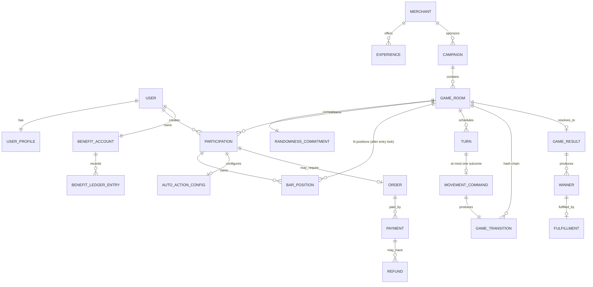
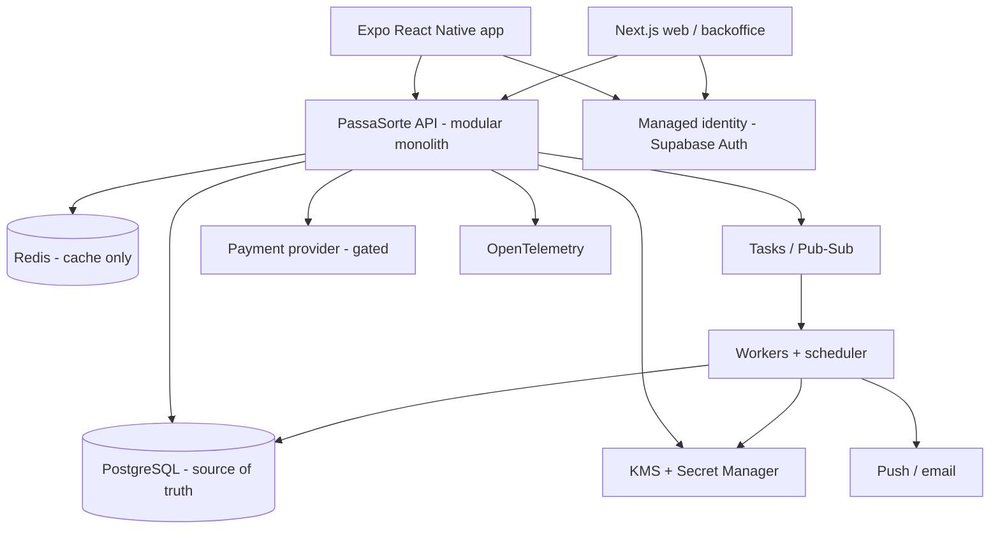

# PASSASORTE

> **Engineering & Product Constitution** — reconciled against `PassaSorte_Core_Regras_Consolidadas.pdf` (Nov 2026) and `PassaSorte_Design_System.pdf` v1.0.
>
> This file is the primary source of truth for product, architecture and engineering decisions in the PassaSorte repository. Anyone (human or AI) who has never heard of PassaSorte must be able to read it and implement features without inventing behavior.
>
> **Priority:** Business correctness > Product clarity > Simplicity > Security > Maintainability > Scalability > Performance > Premature optimization.

---

## 0. Document Control

### 0.1 Status Legend

- **FACT** — explicitly defined by the product owner (the consolidated core PDF, the Design System PDF, or a recorded explicit decision).
- **ASSUMPTION** — a recommended product/technical decision introduced to make implementation coherent. Revisable via ADR or explicit product decision. Never presented to users as a confirmed rule.
- **TBD** — unresolved decision. Claude must not silently invent an answer. Every TBD has an ID (`T-xx`, see §54).
- **LEGAL GATE** — implementation or activation depends on formal legal/compliance approval.
- **EXAMPLE** — a number or scenario used in the source documents to explain a mechanic. **Examples are never universal rules** (e.g. 10 credits, 80%, 8 rounds, 300/420 positions, R$2, R$100).
- **OBSOLETE** — a former rule or assumption superseded by newer explicit decisions. Kept only in §0.3 so nobody re-introduces it.

### 0.2 Reconciliation (Nov 2026)

This file was fully reconciled against the consolidated core rules (`CR-001..CR-033`). The full analysis (new rules, conflicts, removals, TBDs, security/fraud/design reviews, next steps) lives in `docs/CLAUDE_MD_RECONCILIATION.md`. Where this file and the existing code disagree, **this file wins and the divergence is registered in §0.4**. **On 2026-11-11 the product owner closed five of the six engine-blocking TBDs (DECISION-01..06, §6.5); only T-07 (final lock) remains open.**

### 0.3 The Single Most Important Correction

> **PLAYERS DO NOT MOVE. THE SORTE MOVES.** — FACT (CR-002, CR-003)

```text
PLAYER POSITIONS = FIXED  (after the position-selection phase)
SORTE            = MOVABLE (one global position, moved by participants' decisions)
```

Obsolete and **forbidden to implement or extend**:

- `PLAYER_TRANSLATION_V1` / any strategy that translates, shifts or otherwise relocates a participant's positions (former BR-022/BR-023 assumption).
- `MovementCommand.positionIndex` (a command targeting one of the participant's own positions).
- Any UI that lets a participant "drag" or "walk" their own territory during the game.

A movement is a command that displaces **the Sorte** (global shared state). The effect is applied by the GameEngine; the participant never edits their own territory after selection.

### 0.4 Known Code ↔ Constitution Divergences (as of this reconciliation)

The repository was built on the previous constitution. These divergences are **known, registered and must be migrated deliberately** (see §50 and the reconciliation report). Until migrated, the affected code must not be extended and must not be mistaken for product behavior:

| ID | Divergence | Where | Severity |
|----|-----------|-------|----------|
| C-01 | Movement relocates the participant (`PLAYER_TRANSLATION_V1`, `positionIndex`) | `packages/domain/src/game/movement.ts`, `game-engine.ts`, `participation/movement-command-submission.ts`, `api-contract`, mobile `LiveGameScreen` | CRITICAL |
| C-02 | Sorte modeled as a *zone* moved by a simulation random walk; real model is a single point moved only by participants | `sorte.ts`, `sorte-progression.ts`, `game-engine.ts` | CRITICAL |
| C-03 | Positions are held/chosen **at entry** (`PositionHold`); real rule: no advance reservation, choice happens after entries close, in confirmation order | `room/`, `HoldPositionsUseCase`, `position_holds`, mobile `PositionSelectionScreen` | CRITICAL |
| C-04 | Board size fixed in room config at creation; real rule: board size = Σ positions bought by all confirmed participants | `GameConfigSnapshot.board`, `game_rooms.game_config` | CRITICAL |
| C-05 | Fixed "participation packages" (positions+movements bundle) instead of a participant-chosen credits split | `participation-package.ts`, `game_rooms.participation_packages` | HIGH |
| C-06 | No turn model: no participant order per round, no per-turn deadline, no auto-action; "sequence" is supplied by the client | `submit-movement-command.use-case.ts`, mobile `LiveGameScreen` | CRITICAL |
| C-07 | "Final lock / FinalMovementPlan" exists in code and UI but does not exist in the consolidated core (T-07 resolved: the final lock is removed) | `final-lock.ts`, `FinalLockScreen`, `FINAL_LOCK` status | HIGH |
| C-08 | Winner = positions inside a Sorte *zone* (simulation); real rule: winning zone derived from the Sorte's final position, K contiguous positions | `winner-selection.ts` | HIGH |
| C-09 | Temperature assumed individual/normalized/banded; the core PDF leaves formula, levels and scope undefined (Design System defines the 5 visual states) | `temperature.ts` | MEDIUM |
| C-10 | Seed stored in plaintext next to its commitment in `game_runs`; no KMS; allocation randomness not covered | `randomness-commitment.ts`, `game_runs` | HIGH |
| C-11 | No per-transition state-hash chain; steps stored as one JSON blob; no actor/time/previous-state per transition; movement log is mutable at DB level | `game_runs.steps`, `movement_command_logs` | HIGH |
| C-12 | Movement spend is a non-atomic read-modify-write (absolute `used_count`), idempotency key is global/unscoped and a duplicate returns 409 instead of replaying the original result | `SubmitMovementCommandUseCase`, `PrismaIdempotencyRepository` | HIGH |
| C-13 | `GameEngine` exposes only `run()`; required contract is `initialize / applyMovement / calculateWinners / replay` | `game-engine.ts` | HIGH |
| C-14 | Hosting: prior decision = Supabase Postgres, no Cloud SQL, no Pub/Sub/Cloud Scheduler (poller worker); the target architecture lists Cloud SQL/Pub/Sub/Scheduler/KMS | `infrastructure/terraform`, worker | MEDIUM |
| C-15 | `docs/slo/slos.md` says 99.5% / 1% 5xx; constitution targets 99.9% / 0.5% | `docs/slo/slos.md` | LOW |
| C-16 | Pilot simulation script and tests encode the obsolete movement model | `scripts/pilot-simulation/run.ts`, `*.test.ts` | MEDIUM |
| C-17 | Existing board/movement/temperature code may assume a bounded bar (clamped movement, linear distance); no `maxCreditsPerParticipant`; no skipped-turn semantics; `autoAction` without `NONE` (CONFIRMED by audit 2026-11-11: clamp in `movement.ts`/`sorte-progression.ts`, linear distance in `temperature.ts`, `ParticipationPackage`, 0-based positions, client-supplied `sequence`, `FINAL_LOCK` state; see `docs/LEGACY_AUDIT_ENGINE_V2.md`) | `packages/domain/src/game/{board,movement,temperature}.ts`, `participation-package.ts` | HIGH |
| C-18 | Sequential per-participant turns (`turn`, `currentPlayerId`-style turn order, per-turn deadline) and a client-supplied `sequence`; the owner's DECISION-16 replaced them with a **collective round action window** | `advance-room-operations.use-case.ts`, `submit-movement-command.use-case.ts`, mobile `LiveGameScreen`, `api-contract/participations.ts`, `movement_command_logs.sequence` | CRITICAL |
| C-19 | **RESOLVED 2026-11-12:** `BoardQuadrant` / `quadrants` removed from the legacy board model (DECISION-13: `QUADRANTS = DISABLED`) | `packages/domain/src/game/board.ts`, `game-config.ts` | LOW |
| C-20 | Legacy game code (player-translation movement, final lock, engine V1, zone Sorte, participation package, entry holds) is still imported by the API, worker, mobile and pilot script (35 tracked files) and `gameV2` has no consumer yet. Deleting it now would break the build; it was marked DEPRECATED in place (2026-11-13) and is removed only in the contract step of `docs/LEGACY_AUDIT_ENGINE_V2.md`, after the API/worker/mobile are moved to `gameV2` | `packages/domain/src/game/*.ts`, `participation/*`, `room/position-hold.entity.ts` | HIGH |

---

# 1. Product Overview

## 1.1 Short Description

**PassaSorte is a mobile-first platform that connects consumers with businesses through gamified access to products, services and experiences.**

A business offers something desirable — a party, dinner, event, product, membership, voucher — and PassaSorte wraps that offer in an interactive game. Participants do not just pick a number and wait. They decide **how to split a credit budget between territory (positions) and mobility (movements)**, occupy positions on a **horizontal bar**, watch a single shared marker — the **Sorte** — and, on their turn, **move the Sorte** left or right to bring it toward their territory.

The product combines: **Positioning + Movement of the Sorte + Temperature + Time + Experience + Commerce.**

## 1.2 Product Definition — FACT

PassaSorte must not be positioned as a digital raffle app. The broader vision is *a marketplace of gamified experiences connecting consumers and businesses.* Commerce is fundamental. Experiences contemplated: party for dozens of people, barbecue/beer, restaurants, apparel, gym memberships, event access, services, travel, electronics, vouchers, local products.

## 1.3 Core Product Promise — FACT

> **A sorte passa. Você decide onde estar.** (secondary: *A sorte passa. A experiência fica.*)

Product concepts, not mandatory final marketing copy.

## 1.4 Problem for Consumers

Traditional promotions are passive: enter → receive a number → wait → win or lose. PassaSorte turns the wait into ownership of territory, proximity feedback, strategy, live evolution and suspense.

## 1.5 Problem for Businesses

SMBs depend on discounts, paid ads, social reach, coupons. PassaSorte offers a new acquisition/engagement channel: customer acquisition, exposure, leads, engagement, store traffic, benefit redemption, repeat purchases, measurable performance.

## 1.6 Ecosystem Flywheel

```text
BUSINESS → EXPERIENCE → PASSASORTE → USERS → ENGAGEMENT/CONSUMPTION
   → BUSINESS VALUE → MORE BUSINESSES → MORE EXPERIENCES → MORE USERS
```

## 1.7 Initial Commercial Motion — FACT

No merchant self-service in the first MVP. PassaSorte approaches merchants, structures the offer and operates the campaign. A strong internal backoffice is required; onboarding is assisted/manual.

## 1.8 Commercial Model — TBD (T-17, T-18)

The source document gives an **EXAMPLE** (R$100 voucher, R$2 participation, 300 participants), a *suggestion* that the merchant is paid the product value plus a commission on part of the excess (10% was only an example), and a *proposal* that early on PassaSorte may absorb a shortfall so a campaign is not frustrated. **None of this is a final rule.** Claude must not invent price, split, take rate, commission, settlement, minimum participants or loss responsibility.

## 1.9 Paid Participation — LEGAL GATE (CRITICAL, T-21)

The last audio of the source material expresses the *hypothesis* that, because participants' logic and interference affect the outcome, the dynamic "could be framed as a game". The consolidated document is explicit: **this is a product hypothesis, not a legal conclusion**, and does not replace legal opinion on promotions, games, prizes, fundraising, cashback or consumer rules.

Therefore: the architecture must support the desired product but **must not encode an assumption that paid participation is legal**. The product must **not be altered merely to "look legal"** — the system is built flexibly to operate under whatever model is legally approved. Paid participation, prize distribution, cashback and any economically sensitive feature remain feature-gated (default OFF) until formal approval is recorded.

## 1.10 Core Actors

Participant; merchant partner; PassaSorte operations; administrator; support; finance/settlement; compliance; external providers; automated GameEngine; notification infrastructure; payment provider (if activated).

---

# 2. Product Principles

2.1 **Experience first** — an experience platform, not a spreadsheet of raffle numbers.
2.2 **Strategic participation** — "choose how much territory and how much mobility, choose where to be, observe, decide how to react".
2.3 **Controlled uncertainty** — a participant knows their own state precisely; information about others is intentionally limited.
2.4 **Fairness must be demonstrable** — randomness is server-side, committed before use, tamper-evident, reproducible, versioned, administrator-proof (§25).
2.5 **The server is authoritative** — the client never owns game state, positions, Sorte position, remaining movements, result, winner, price, balance, payment, time or order (§18).
2.6 **Mobile first**; **low friction** (public discovery before login).
2.7 **Local commerce value** — merchants are not prize suppliers only; value must be measurable.
2.8 **Auditability over convenience** — every game is reconstructible (§24).
2.9 **Configuration over hard-coding** — no EXAMPLE value (10 credits, 80%, 8 rounds, 5/8/10 s, bar size, room size, price) may become a magic number (§7, §8.2).
2.10 **Simplicity that preserves invariants** — modular monolith, boring technology, no speculative distribution.
2.11 **Product language** — prefer *entrar, participar, posição, território, movimento, Sorte, temperatura, rodada, turno, experiência*. Avoid *aposta, apostador, cassino*. (The source audios say "jogada/jogador"; user-facing copy should prefer *movimento/participante* — T-28.)
2.12 **Things that would disfigure PassaSorte** — a raffle list, a lottery clone, a static number picker, a coupon directory, a casino lobby, a game where strategy has no real effect.
2.13 **Locale (FACT, BR-048)** — pt-BR / BRL. All user-facing text is Brazilian Portuguese. Code identifiers, comments, commits and internal docs (this file, ADRs) are English.

---

# 3. Terminology

| Term (pt-BR) | Meaning |
|---|---|
| **Barra** (bar) | The single circular sequence of positions 1..N on which the game happens; N is known only after entries close. Replaces the former 2D board/quadrants (disabled, DECISION-13). |
| **Posição** (position) | One cell of the bar. Room-scoped. Exclusive: owned by exactly one participant. |
| **Sorte** | The one global marker on the bar. The only mobile entity. Moved by participants' accepted movements. |
| **Crédito** (credit) | In-game budget unit each participant splits between positions and movements. How credits relate to money is TBD (T-17). |
| **Jogada / Movimento** (movement) | One unit of mobility bought with a credit; used to displace the Sorte. |
| **Território** | The set of positions a participant owns (may be contiguous or scattered). |
| **Período de entrada** | Phase in which participants join and declare *how many* positions and movements they want. |
| **Fase de escolha de posições** | Phase after entries close in which participants choose their exact positions, in entry order. |
| **Ordem de entrada** (`entrySequence`) | Server-assigned sequence of confirmed participations; drives pick priority and is an auditable attribute of every action. |
| **Rodada** (round) | One pass with a collective action window in which every participant may submit a decision; the server then resolves it. |
| **Janela da rodada** (action window) | The configurable time (`roundActionWindowSeconds`) in which all participants may register their action for the round. |
| **Ação automática** | Pre-configured per-participant decision (LEFT / RIGHT / STAY) executed if the participant is absent when the round window closes. |
| **Zona vencedora** | The block of K contiguous positions (K ≥ 1, campaign-configured) derived from the Sorte's final position. |
| **Temperatura** | Proximity feedback between a participant and the Sorte (Congelando · Frio · Morno · Quente · Muito quente). |
| **Experiência** | The merchant's offer (product/service/voucher/event). |
| **Campanha / Sala** | Campaign = commercial container; Room = one game instance of a campaign. |
| **Replay** | Deterministic reconstruction of a game from immutable history. |

---

# 4. Actors and Personas

| Actor | Can | Cannot |
|---|---|---|
| Anonymous visitor | Read public campaigns, merchants, FAQ, legal content | Participate, manage data |
| Participant (`PARTICIPANT`) | Manage account; join campaigns; split credits; choose positions; configure auto-action; take turns; monitor Sorte/temperature; see result; redeem eligible benefits; contact support | See other participants' private state; act outside own turn |
| Merchant partner / `MERCHANT_OPERATOR` | Provide experience; (future) validate redemptions, confirm fulfillment | Influence game outcome |
| `OPERATOR` | Operate merchants, experiences, campaigns, rooms | Move the Sorte, change seed/result/winners, edit history |
| `SUPPORT` | Inspect users/participations, open cases | Change winners or any ledger/history |
| `FINANCE` | Inspect payments, refunds, reconciliation, settlement | Alter game state; mutate ledger entries (only compensating entries) |
| `COMPLIANCE` | Control legal/compliance gates and regulated features | Alter game history |
| `ADMIN` | Manage users/roles/flags/platform | **Anything that rewrites historical facts** (§17.3) |
| GameEngine | Authoritative internal actor for state transitions | — |
| Payment provider / notification providers | External | Never authoritative for game state |

---

# 5. User Journeys

## 5.1 Journey summary (reconciled)

1. **Discover** — public catalog → campaign detail (experience, merchant, schedule, how it works, mandatory conditions). Recovery: retry / safe cached public data.
2. **Sign up / Login / Recover** — managed identity (Supabase Auth); return the user to original intent; no user enumeration.
3. **Enter a campaign (entry period)** — validate eligibility → choose the **credits split** (positions × movements) within campaign limits → (if applicable) pay → participation **CONFIRMED** and assigned a server-side `entrySequence`. **No specific position is chosen or held at this point (CR-010).**
4. **Configure automatic action** — participant pre-configures `autoAction` ∈ {LEFT, RIGHT, STAY, NONE} to be used if absent at a turn (CR-027, DECISION-03/04). `NONE` means the turn is skipped without consuming movement.
5. **Entries close** — the bar size is now known: `N = Σ positions of all confirmed participations` (CR-004).
6. **Position selection** — in `entrySequence` order (whoever entered first chooses first, DECISION-08), each participant chooses **exactly which positions** they want, concentrated or scattered (CR-009, DECISION-07). The last participant receives only what is left; the bar never grows (DECISION-11). No automatic selection while the participant is present; absent participants receive server-chosen random positions (CR-012), and this rule must appear in the terms (CR-013). The match starts only when **every position has an owner** (DECISION-09).
7. **Game start** — the Sorte's initial position is generated server-side, randomly and auditably (CR-014/CR-015).
8. **Rounds with a collective window** — each round opens an **action window** (`roundActionWindowSeconds`, configurable) in which **all participants** may submit their decision at the same time (DECISION-16/17). They may move the Sorte LEFT/RIGHT (and STAY) consuming ≥1 movement credits (CR-020..022). When the window closes the server resolves the round (absent participants follow DECISION-03/04), computes the new Sorte position and reveals it; per-participant detail is available in the audit/replay (DECISION-19/21). The Sorte may change a lot between rounds (DECISION-20). Rounds may be spread across hours and days (CR-017); campaign timing is configurable (DECISION-12).
9. **Live monitoring** — participant sees own positions, the Sorte position and own temperature (CR-026). Closing the app does not pause the game; reopening rebuilds authoritative state.
10. **Result** — the Sorte stops; the winning zone and winning participants are derived (CR-028..031); full replay is available (CR-033).
11. **Fulfillment / benefits** — winner notification → eligibility → fulfillment tracking → merchant/PassaSorte action; benefits only if legally enabled.
12. **Support, account deletion (LGPD), merchant onboarding, campaign creation/cancellation** — as in §5.3.

## 5.2 Round timing (DECISION-12, 16, 17, 18)

Each campaign configures its own timing (`entryOpenAt`, `entryCloseAt`, `gameStartAt`, `roundSchedule`, `resultAt`, or an equivalent) and the length of the action window (`roundActionWindowSeconds`; 30 s, 1 min and 2 min were only examples). Nothing is hard-coded; templates (EXPRESS, CLASSIC, WEEKEND, SPECIAL_EVENT) are a future evolution. The server owns every deadline: a submission is accepted only while `serverTime < actionWindowClosesAt`; the client countdown is presentation only. When a window opens the app must get the participant's attention (push, in-app, sound, haptic, countdown, a clear change of state) without casino/bet aesthetics (DECISION-18).

## 5.3 Operational journeys (unchanged from previous constitution — still valid)

- **Merchant onboarding:** operator creates merchant, locations, experience, fulfillment info.
- **Create campaign:** merchant/experience → campaign metadata → rooms → game config → timing → compliance → preview → approval → publication.
- **Cancel campaign:** stop entries, preserve history, notify, execute required refund/benefit recovery, audit. Cancellation is terminal.
- **Delete account:** erase/anonymize allowed data; retain mandatory financial/audit records (§21).
- **Winner fulfillment:** winner notification → eligibility check → fulfillment record → merchant/PassaSorte action → completion.
- **Redeem benefit:** verify balance, eligibility, merchant, expiration, single-use token; atomically redeem (feature-gated).

## 5.4 Functional Requirements catalog (IDs preserved; status updated)

**Identity & account:** FR-001 registration · FR-002 authentication · FR-003 logout · FR-004 access recovery · FR-005 profile · FR-006 account deletion (LGPD).
**Discovery:** FR-007 campaign catalog · FR-008 campaign detail · FR-009 merchant public profile.
**Merchant & experience:** FR-010 merchant management · FR-011 locations · FR-012 experience management (snapshot at publication).
**Campaigns:** FR-013 create draft · FR-014 configure · FR-015 approve · FR-016 publish · FR-017 cancel.
**Rooms & bar:** FR-018 multiple rooms · FR-019 room capacity/limits *(revised: bounds, not a fixed board)* · FR-020 **dynamic bar** *(revised: size derived from Σ positions)* · FR-021 ~~quadrants~~ *(OBSOLETE: no 2D board; optional visual segmentation only)* · FR-022 position availability *(revised: during selection phase)* · FR-023 position selection (contiguous/scattered) · FR-024 **atomic position acquisition** *(revised: no entry-time hold)* · FR-025 ~~hold expiration~~ *(revised: pick-turn expiration)* · FR-026 position commitment.
**Participation:** FR-027 participation record · FR-028 eligibility (server) · FR-029 **credit split** *(revised: replaces fixed packages)* · FR-030 confirmation only after all conditions · **FR-073 confirmation order** · **FR-074 automatic action configuration** · **FR-075 absent-picker random allocation**.
**Game:** FR-031 versioned engine · FR-032 frozen game configuration · FR-033 authoritative Sorte state · FR-034 temperature · FR-035 movement allowance · FR-036 LEFT/RIGHT (+STAY) movement of the **Sorte** · FR-037 movement validation · FR-038 idempotent movement submission · ~~FR-039 final lock / FR-040 immutable final strategy~~ *(TBD T-07: not in consolidated core)* · FR-041 automatic round evolution · FR-042 server-side result resolution · FR-043 immutable winner persistence · FR-044 replay for audit · **FR-076 turn scheduling & timeout** · **FR-077 state-hash chain**.
**Temperature:** FR-045 distance · FR-046 classification · FR-047 exact distance (non-MVP, configurable).
**Payments (LEGAL GATE):** FR-048 order · FR-049 intent · FR-050 async confirmation · FR-051 idempotency · FR-052 refund · FR-053 reconciliation.
**Benefits (LEGAL GATE):** FR-054 grant · FR-055 ledger · FR-056 expiration · FR-057 redemption · FR-058 replay protection.
**Notifications:** FR-059 in-app · FR-060 push · FR-061 email · FR-062 preferences.
**Backoffice:** FR-063 auth · FR-064 campaign ops · FR-065 user search · FR-066 participation inspection · FR-067 financial inspection · FR-068 game audit viewer · FR-069 audit log viewer · FR-070 feature flags · FR-071 compliance gate · FR-072 support cases.

---

# 6. Core Game Rules

Source: `PassaSorte_Core_Regras_Consolidadas.pdf`. All `CR-xxx` below are **FACT** unless tagged. Examples are labeled and are not rules.

## 6.1 The consolidated rule catalog

| ID | Rule | Tag |
|----|------|-----|
| CR-001 | The main environment is a **sequential horizontal bar**. | FACT |
| CR-002 | Participants stay **fixed** after choosing positions. | FACT |
| CR-003 | **The Sorte is the element that moves** along the bar. | FACT |
| CR-004 | Bar size = Σ positions acquired by participants. | FACT |
| CR-005 | Initially rooms are **open** — no fixed small player limit. | FACT |
| CR-006 | Smaller rooms are a **future evolution**. | FACT |
| CR-007 | Each participant distributes credits between **positions and movements**. | FACT |
| CR-008 | In the **10-credit model**, no category may exceed 8 credits. | EXAMPLE only. Superseded in part by DECISION-02/05 (single credit unit; per-campaign `maxCreditsPerParticipant`); per-category min/max remain configuration (T-08, narrowed) |
| CR-009 | Positions may be concentrated or spread along the bar. | FACT |
| CR-010 | **No advance reservation** of specific positions during entry. | FACT |
| CR-011 | Confirmed entry/participation **order** determines position-pick priority. | FACT; reinforced by DECISION-08 (`entrySequence`: persisted, immutable, auditable, server timestamp, transactional) |
| CR-012 | Absence during position pick → system allocates randomly. | FACT; applies **only** to absent participants (DECISION-07: no automatic selection while present) |
| CR-013 | The automatic-allocation rule must appear in the terms. | FACT |
| CR-014 | The Sorte's initial position is random. | FACT |
| CR-015 | The initial placement must be auditable. | FACT |
| CR-016 | The model allows up to 8 rounds when max movements is 8. | EXAMPLE-derived; round count TBD (T-09) |
| CR-017 | Rounds may occur at different times and across more than one day. | FACT |
| CR-018 | Within each round, participants act **sequentially** (original order). | **SUPERSEDED by DECISION-16 (2026-11-12):** all participants act inside one collective window; the order in which the server applies the actions is TBD (T-32) |
| CR-019 | Each turn has a **limited time**. | **REVISED by DECISION-16/17:** each round has a limited **action window**, `roundActionWindowSeconds`, configurable per campaign (T-03 resolved) |
| CR-020 | A participant may move the Sorte **left or right**. | FACT |
| CR-021 | The mechanic includes **STAY** ("manter"). | FACT; STAY executed as an automatic action consumes 1 movement (DECISION-03); a manually executed STAY also costs 1 movement (ASSUMPTION, T-31a) |
| CR-022 | A participant may consume **multiple movements in one turn**. | FACT |
| CR-023 | Unused movements remain available **while the match rules allow**. | FACT; skipped turns consume nothing and movements stay usable in the same participation; at the end they **EXPIRE** — no cashback, refund, transfer or carry-over (DECISION-04). Per-turn cap: `maxMovementsPerRound` (BR-068) |
| CR-024 | Every move modifies a **global shared state**. | FACT; applied by the server at round resolution |
| CR-025 | The next participant receives the Sorte at the position resulting from the previous move. | **REVISED by DECISION-16:** the state is shared per round; participants see the new Sorte position after the round resolves |
| CR-026 | The participant follows the Sorte and their own positions. | FACT |
| CR-027 | An absent participant may use a **previously configured automatic decision**. | FACT; if none is configured the turn is skipped without consuming movement (DECISION-04) |
| CR-028 | The final result depends on where the Sorte ends. | FACT |
| CR-029 | A campaign may have one or several winning positions. | FACT; **MVP: `winningZoneSize = 1`** (DECISION-06); K > 1 is a future evolution |
| CR-030 | Initially, multiple winning positions are **contiguous**. | FACT (non-contiguous = future) |
| CR-031 | One participant may hold several winning positions. | FACT |
| CR-032 | The exact prize split among winners is **not yet formalized**. | Not applicable in MVP (1 position → 1 winner); remains TBD for K > 1 (T-11, future) |
| CR-033 | Every match must generate a **complete audit/replay**. | FACT |

## 6.2 Mechanics in detail

**Bar & positions.** The bar has no universal size. Each room produces its own `N` from the sum of positions its confirmed participants bought. Positions are exclusive (each belongs to exactly one participant; ADR-017) — ASSUMPTION implied by CR-004 ("300 casas" from Σ). Because every position is bought and every absent picker is auto-allocated, **every position of the final bar is owned**; the "empty winning zone" worry of the previous constitution disappears structurally (it can only recur if positions are left unassigned — forbidden).

**Credits & strategy.** There is a **single credit unit** (DECISION-02): `1 credit = 1 position OR 1 movement`, same cost for both. The decisive pre-game choice is how a participant splits the credits they buy between positions and movements (EXAMPLE: 10 credits → 8+2, 6+4, 5+5, 2+8). The monetary value of a credit is configuration (`creditUnitPrice`, integer minor units, per campaign) and is **separate from** `creditQuantity`; BRL figures in the examples are never constants. Each campaign sets `maxCreditsPerParticipant` (DECISION-05), enforced server-side. Per-category minimum/maximum (e.g. at least one position; the former "80%" example) and the number of rounds remain campaign configuration (T-08 narrowed, T-09).

**Phases (DECISION-10).** Entry period (each participant declares positions + movements + autoAction; no bar exists yet) → entries close → `boardSize = Σ position credits` → position selection in `entrySequence` order → all positions owned (`allocatedPositions == boardSize`, `EMPTY_POSITIONS = 0`) → initial Sorte placement (random, server-side, auditable) → collective rounds → end → result → audit. A participant cannot pick specific positions before entries close (CR-010).

**Order (T-32, approved 2026-11-12).** `entrySequence` gives pick priority (CR-011, DECISION-08), which is a real benefit of entering early, and is also the order in which a round's actions are applied (`ENTRY_SEQUENCE_V1`, recorded per round in the audit). With additive circular displacement the Sorte position at the end of a round is the same for any order; only the per-action before/after positions in the audit depend on it. A different policy in the future is a new policy id, never a silent change.

**Movement.** At a turn the participant spends ≥1 movement credits to displace the Sorte LEFT (toward lower positions) or RIGHT (toward higher positions), or STAY. Each credit displaces the Sorte by **exactly one position** (owner's worked examples, DECISION-01). The bar is **circular** (`BAR_BOUNDARY_POLICY = CIRCULAR`): `N + RIGHT → 1` and `1 + LEFT → N`, in both directions; CLAMP, REJECT and BOUNCE/REVERSE_DIRECTION are forbidden. One command may spend several credits (e.g. RIGHT ×5). The state mutation is shared and applied by the server when the round is resolved (DECISION-16). **EXAMPLE:** Sorte at 100 at the start of a round; the round's submissions are RIGHT ×3 and LEFT ×1 → the Sorte is revealed at 102. **EXAMPLE (wrap):** bar of 200, Sorte at 198, RIGHT ×4 → 199, 200, 1, 2 → final position 2.

**Rules adopted on 2026-11-11 as ASSUMPTIONS (authorized by the owner, revisable; §6.5):** the "final lock / final plan" does not exist (T-07) and the semantics grouped in T-31 are fixed (STAY cost, per-turn cap, no explicit pass, definition of "absent", zero-balance auto-action, auto-action = exactly 1 movement). No rule that blocked Engine V1 remains open.

**Absence.** Two distinct absences exist and must never be conflated: (a) absence at **position pick** → server random allocation of free positions (not a move); (b) absence in a **round** (no accepted player action before `actionWindowClosesAt` on the server clock; DECISION-16, T-31d) → if the participant has a configured `autoAction` (LEFT | RIGHT | STAY) it executes as a normal move, consumes **1 movement** and is recorded `executionType = AUTOMATIC`; if `autoAction = NONE` the turn is **skipped**, **no movement is consumed** and the participant is notified (DECISION-03/04).

**Result.** When rounds end the Sorte stops. **MVP: `winningZoneSize = 1`** (DECISION-06): the Sorte's final position *is* the winning position and its owner is the single winner; because every position is owned (see "Bar & positions"), exactly one winner always exists. The engine keeps `winningZoneSize` as configuration so K > 1 can be added later, but K > 1 is **not activatable** until the zone-expansion rule and the prize-split rule are formally defined (T-05, T-11 — future); the engine rejects K > 1 for real rooms. Do not invent the expansion rule.

**Audit.** The record must contain: initial Sorte record (`gameId`, `boardSize`, `engineVersion`, `randomnessCommitment`, `initialLuckPosition`, `generatedAt`), `entrySequence`, and **for every participant in every round**: round number, window open/close, `actionSubmittedAt`, the action, manual/automatic, movements consumed, `resolutionSequence`, `luckPositionBefore`, `luckPositionAfter` (DECISION-21); final position, winning zone, winners, complete replay (CR-033). `resolutionSequence` only becomes definitive once T-32 is decided.

**Temperature.** The core PDF only states intent (cold / approaching / hot, derived from proximity between the Sorte and the participant's territory) and leaves formula, number of levels, intervals and individual-vs-global scope **undefined (T-10)**. The Design System defines the five visual/semantic states **Congelando · Frio · Morno · Quente · Muito quente**; the mapping from distance to state is configuration. Because the bar is circular, **distance is circular distance**: `min(abs(a − b), N − abs(a − b))` (BR-014).

**Temperature and quadrants (DECISION-13/14).** Quadrants are disabled in the MVP (`quadrantsEnabled = false`) and quadrant-based round scheduling is NOT NOW (DECISION-22). The temperature concept stays (FRIO / MORNO / QUENTE; the Design System keeps its five visual states) but its mapping is **TBD (T-10)**: the engine must not invent thresholds, and linear quadrants are wrong on a circular bar (on a bar of 60, position 55 is 10 away from position 5). When temperature is implemented the distance is `circularDistance`.

**Why a collective window (DECISION-16/19/20).** A sequential playback of hundreds of participants would be slow, predictable and boring. The collective window keeps uncertainty and expectation: the Sorte can move a lot between rounds, so a participant who looks far away can become relevant again. This must emerge only from the legitimate rules, never from artificial manipulation. The UI may animate the processing aggregated (processing → Sorte moves → new position revealed); full detail lives in audit/replay.

## 6.3 Worked example (EXAMPLE, not rules)

100 participants enter, each with 10 credits and a chosen split. Σ positions = 420 → bar 1..420. Positions are picked in confirmation order; absentees get random positions. Initial Sorte: 187. P1 (territory near 170) plays ← ← ← ← : 187→183. P2 (positions at 190 and 205) plays → → → : 183→186. After all rounds the Sorte stops at 272. **At MVP (`winningZoneSize = 1`) position 272 is the winning position and its owner is the sole winner.** (A block such as 270–274 would be a possible *future* K = 5 example; its expansion rule is undefined.) **Wrap example:** bar of 200, Sorte at 198, RIGHT ×4 → 199 → 200 → 1 → 2.

## 6.4 Things the core does NOT say (do not invent)

Participant movement; a player-owned-position translation; a final strategy lock; a 2D board or quadrants (disabled in the MVP, DECISION-13); the order in which a round's simultaneous actions are applied (T-32); temperature thresholds (T-10); whether a submitted action can be edited before the window closes (T-33); a Sorte "zone width" before the end; price, credits-to-money ratio (a credit's monetary value is per-campaign configuration), prize value, minimum participants, universal round count, universal turn duration, the zone-expansion rule for K > 1, split formula, cashback rules.

## 6.5 Owner decisions of 2026-11-11 (FACT)

Explicit product decisions; they override any earlier ASSUMPTION or TBD. The numbers in their examples (10/20 credits, R$ 0,50/5/10, 200/300 positions) are **EXAMPLES, never constants**.

| ID | Decision | Rule |
|----|----------|------|
| DECISION-01 | Circular bar | `BAR_BOUNDARY_POLICY = CIRCULAR`: `N + RIGHT → 1`, `1 + LEFT → N`, both directions; 1 position per movement credit. CLAMP, REJECT and BOUNCE/REVERSE_DIRECTION are not used. Closes T-02 and (through the worked examples) T-01. |
| DECISION-02 | Single credit unit | `1 credit = 1 position OR 1 movement`, same cost. Money value is configurable per campaign (`creditUnitPrice`) and separate from `creditQuantity`. |
| DECISION-03 | Absent with `autoAction` | `autoAction ∈ {LEFT, RIGHT, STAY, NONE}`. If absent and `autoAction ≠ NONE`: execute it as a normal move, consume 1 movement, `executionType = AUTOMATIC` (vs `MANUAL`). |
| DECISION-04 | Absent without `autoAction` | Skip the turn, consume nothing, notify the participant (pt-BR: "Você perdeu sua vez porque estava ausente. Seus movimentos continuam disponíveis nesta partida."). Remaining movements stay usable later in the same participation and **EXPIRE** at its end: no cashback, refund, balance, transfer or carry-over to another draw/campaign. Movement credits are campaign-scoped. |
| DECISION-05 | Credit cap | Each campaign has `maxCreditsPerParticipant`. Enforced server-side and cumulatively; an over-limit purchase is rejected in full, never accepted and corrected later. |
| DECISION-06 | Winner in the MVP | `winningZoneSize = 1`: final Sorte position → winning position → 1 winner. No block, no multiple winners, no split. The engine must be designed so K > 1 can be added later; the expansion rule is **not** defined and must not be invented. |

**Assumptions adopted 2026-11-11 (T-07, T-31 — authorized by the owner, revisable):**

- **No final lock (T-07).** The game ends at the last round; the result is resolved right after. `FINAL_LOCK` / `LOCKED` and the final-plan code are removed (expand/contract). ~~Turn order stays fixed in every round~~ **Superseded by DECISION-16:** all participants act in one collective window, so nobody observes others before acting; the strategic-hoarding concern (R-21) remains and is to be simulated before the pilot.
- **a — STAY.** A manually executed STAY consumes 1 movement, like an automatic STAY.
- **b — Per-turn cap.** The engine supports `maxMovementsPerRound` (campaign setting, applies to manual commands). **No default value:** creating a campaign requires an explicit number or an explicit "no limit" (`null`); the backoffice warns on `null`.
- **c — No explicit pass.** There is no "pass" command. Passing = not acting before the deadline, which makes the participant "absent" (the `autoAction` rule applies).
- **d — Absent.** No accepted command by the server deadline, measured by the server clock. Behavior exactly at the deadline stays in T-03.
- **e — Zero balance.** An auto action with zero movement balance is a skipped turn with reason `NO_MOVEMENTS_LEFT` (different participant message from `ABSENT_NO_AUTO_ACTION`).
- **f — Auto action.** Always exactly 1 movement (one step), so it never exceeds `maxMovementsPerRound`.
- A skipped turn is recorded as a hash-chained transition; distance/temperature use circular distance.


## 6.6 Owner decisions of 2026-11-12 (FACT)

Explicit product decisions; the newest decision wins over earlier text. Numbers in the examples are **EXAMPLES, never constants**.

| ID | Decision | Rule |
|----|----------|------|
| DECISION-07 | Exact choice of positions | The participant chooses exactly which positions to occupy (e.g. 7, 18, 42, 61 or 30, 31, 32, 33); concentrate or distribute is the participant's strategy. No automatic selection while the participant is present. |
| DECISION-08 | Entry order = pick priority | Order of confirmed entry defines who chooses first. `entrySequence` is persisted, immutable once confirmed, auditable, from the **server** clock/counter (never the client's), assigned transactionally with no ties or duplicates. |
| DECISION-09 | No empty positions | `boardSize = Σ positions acquired`; every position belongs to a participant; invariant `allocatedPositions == boardSize` and `EMPTY_POSITIONS = 0` when the match starts. |
| DECISION-10 | Bar created after entries close | Flow: campaign opens → participants enter (positions + movements) → entry closes → sum of positions → `boardSize` → position selection in entry order → all positions owned → match ready. During entry there is no definitive bar, only each participation's composition. |
| DECISION-11 | Last picker takes what is left | No extra positions, no bigger bar. Entering early gives more choice. ("Quem entra antes escolhe antes." is only an example of copy.) |
| DECISION-12 | Configurable campaign timing | `entryOpenAt`, `entryCloseAt`, `gameStartAt`, `roundSchedule`, `resultAt` (or equivalent) per campaign; templates (EXPRESS, CLASSIC, WEEKEND, SPECIAL_EVENT) are a future evolution. Do not hard-code days or hours. |
| DECISION-13 | No quadrants in the MVP | `QUADRANTS = DISABLED` (`quadrantsEnabled = false`). Do not model Q1..Q4 in Game Engine V1. |
| DECISION-14 | Temperature: concept yes, formula TBD | FRIO / MORNO / QUENTE stay as UX concept and DS states; no thresholds invented; distance must be circular: `min(abs(a−b), N−abs(a−b))`. |
| DECISION-15 | Random, auditable initial Sorte | Random + server-side + auditable; never by client, never by an administrator. Record `gameId, boardSize, engineVersion, randomnessCommitment, initialLuckPosition, generatedAt`; `1 ≤ initialLuckPosition ≤ boardSize`; commit/reveal stays valid. |
| DECISION-16 | Collective round window | All participants may submit within the same window of the round (`ROUND_ACTION_WINDOW = OPEN`); the sequential per-player model is no longer the MVP's main model. |
| DECISION-17 | Configurable window length | `roundActionWindowSeconds` per campaign or game configuration (30 s / 1 min / 2 min were examples). |
| DECISION-18 | Strong round alert | Push, in-app, sound, haptics, countdown, clear state change ("Sua rodada começou. Você tem 60 segundos para decidir." is example copy); no casino/bet aesthetics. |
| DECISION-19 | No slow playback | No animated sequential playback of hundreds of participants; aggregate visual, full detail in audit/replay. |
| DECISION-20 | Sorte may jump between rounds | Desired product trait; must come only from legitimate rules, never artificial manipulation. |
| DECISION-21 | Detailed audit per participant per round | Round, participant, `entrySequence`, movements, directions, execution type, timestamp, `luckPositionBefore/After`, `resolutionSequence` (§6.2 Audit). |
| DECISION-22 | No quadrant-based rounds now | `QUADRANT_BASED_ROUND_SCHEDULING = NOT NOW`. |

**Related rules stated with them:** one effective action per participant per round — the participant may replace it until the window closes and the **last submission counts** (T-33, approved 2026-11-12); idempotency by `participationId + roundId + idempotencyKey`; after `serverTime >= actionWindowClosesAt` no new submission is accepted and the app's visual state is never trusted; offline participants follow DECISION-03/04 (`autoAction ≠ NONE` → automatic move; `NONE` → skip without consuming).

**Decisions of 2026-11-13 (FACT; Bruno accepted the suggestions of the simulation report `docs/SIMULACAO_ENGINE_V2.md`; the partner may revisit):** (1) the per-round movement limit is mandatory in every campaign (BR-089); the value stays per campaign and is not defined here; (2) the participant sees only the temperature, never the Sorte's exact position (BR-090); (3) a strategy advantage over casual play is accepted and measured in the pilot (BR-091).

**Approved on 2026-11-12 (11:42; the partner accepted the suggestions of the PDF "3 perguntas em aberto"):** T-32 actions are applied in `entrySequence` order; T-33 a submission can be replaced until the window closes and the last one counts; T-10 (partial) the temperature has **5 levels** (as in the Design System), measured as a **percentage of the bar size** (valid for any board size), and the participant sees the level only, **never the exact distance**.

**Approved on 2026-11-13 (the partner agreed with the owner's answers and with the suggestions):** T-10 is resolved. Initial limits, in % of the bar size (inclusive upper bounds): **Muito quente ≤ 2%, Quente ≤ 6%, Morno ≤ 15%, Frio ≤ 30%, Congelando > 30% (up to 50%, the circular maximum)**. They are **configuration** (frozen in the room's config snapshot, `INITIAL_TEMPERATURE_BANDS` in the engine), **starting values subject to adjustment after the test and the pilot**, not engine constants. The visibility question (Sorte position hidden) is decided by BR-090. The temperature-only simulation (`docs/SIMULACAO_TEMPERATURA.md`) suggests these bands run hot at low position density (Congelando ≈ 2%, Muito quente ≈ 19% of observations), so review them with real pilot data.

---

# 7. Business Rules

Legend: ✔ unchanged · ✎ revised by reconciliation · ✖ obsolete · ★ new.

| ID | Rule | Status |
|----|------|--------|
| BR-001 | Campaign is the commercial container. | ✔ |
| BR-002 | Every commercial campaign references a merchant and an experience snapshot. | ✔ |
| BR-003 | A campaign can contain multiple rooms. | ✔ |
| BR-004 | Rooms have configured **limits** (min/max participants, T-12) — no hard-coded small size (CR-005). | ✎ |
| BR-005 | ~~Board size is configurable.~~ **Bar size is derived: N = Σ positions** of confirmed participations (CR-004). | ✎ |
| BR-006 | Position number is room-scoped. Internal indexing base (0 or 1) is an implementation detail; **API, UI and audit use 1..N** (matches the source). | ✎ ASSUMPTION |
| BR-007 | A participant may own multiple positions. | ✔ |
| BR-008 | Positions need not be contiguous. | ✔ (CR-009) |
| BR-009 | Positions are exclusive; a position never belongs to two participants. | ✔ ASSUMPTION (ADR-017) |
| BR-010 | Position acquisition is atomic and happens **in the selection phase** (not at entry). DB is the final guard. | ✎ |
| BR-011 | ~~Hold is not ownership.~~ Entry-time holds are removed. During selection, an in-progress pick is bounded by the picker's pick window. | ✎ |
| BR-012 | ~~Sorte is a zone/range.~~ **The Sorte is a single global position.** A *winning zone* of K contiguous positions is derived only at the end. | ✎ |
| BR-013 | ~~Sorte zone width configurable.~~ **Winning-zone size K is a campaign setting (`winningZoneSize`); MVP value = 1** (DECISION-06). K > 1 cannot be activated until the zone-expansion rule is defined. | ✎ FACT |
| BR-014 | Player distance = minimum **circular** distance, `min(abs(a − b), N − abs(a − b))`, from any of the participant's positions to the Sorte. | ✎ ASSUMPTION (T-10) |
| BR-015 | Temperature derives from (normalized) distance. | ASSUMPTION (T-10) |
| BR-016 | Temperature bands are configurable, not hard-coded. | ✔ |
| BR-017 | Temperature is personalized; exact player state is private. | ASSUMPTION (T-10) |
| BR-018 | Exact player state (positions, remaining movements, auto-action) is private to the participant (and audit roles). | ✔ |
| BR-019 | Live occupancy may be hidden subject to legal disclosure obligations. | ✔ |
| BR-020 | Credits (single unit, DECISION-02) are split between positions and movements within campaign limits; `creditQuantity ≤ maxCreditsPerParticipant`; movement balance is finite and cannot go negative. | ✎ |
| BR-021 | Directions: LEFT, RIGHT and STAY (CR-020/021). STAY costs 1 movement when executed (ASSUMPTION, T-31a). | ✎ |
| BR-022 | ~~Exact movement effect TBD.~~ Movements displace **the Sorte** by exactly one position per credit on a **circular** bar: `N + RIGHT → 1`, `1 + LEFT → N` (`BAR_BOUNDARY_POLICY = CIRCULAR`; CLAMP/REJECT/BOUNCE forbidden). | ✎ FACT (DECISION-01) |
| BR-023 | ~~PLAYER_TRANSLATION_V1~~ | ✖ OBSOLETE |
| BR-024 | Engine version and game config are immutable once a room starts. | ✔ |
| BR-025 | Server clock is authoritative for all deadlines. | ✔ |
| BR-026 | Game steps are sequence-numbered by the **server**; the client never supplies sequence/round. | ✎ |
| BR-027 | ~~Final phase threshold configurable.~~ | ✖ OBSOLETE (no final lock, T-07) |
| BR-028 | ~~Final sequence immutable.~~ (Every accepted command is immutable — see BR-046.) | ✖ OBSOLETE (no final lock, T-07) |
| BR-029 | ~~Missing final submission behavior TBD.~~ Replaced by the absent-turn rule (BR-052). | ✖ |
| BR-030 | Randomness is cryptographically committed, auditable and reproducible. | ✔ strengthened (§25) |
| BR-031 | No administrator can replace a committed seed or alter result. | ✔ strengthened |
| BR-032 | Winner calculation is server-side and deterministic. | ✔ |
| BR-033 | Winner semantics: **MVP: 1 winning position → 1 winner** (the owner of the Sorte's final position). For future K > 1: winners = owners of ≥1 zone position; split rule TBD (T-11). | ✎ FACT (DECISION-06) |
| BR-034 | Paid participation is a LEGAL GATE. | ✔ |
| BR-035 | Money uses integer minor units; never floats. | ✔ |
| BR-036 | Provider/backend confirm payments, never the frontend. | ✔ |
| BR-037 | Financial commands are idempotent. | ✔ |
| BR-038 | Benefits are non-withdrawable and non-transferable until explicitly approved. | ✔ LEGAL GATE |
| BR-039 | Benefit balance derives from an immutable ledger. | ✔ |
| BR-040 | Internal campaign economics are private unless disclosure is required. | ✔ |
| BR-041 | Internal economics must be measurable. | ✔ |
| BR-042 | Progressive pricing is NOT MVP. | ✔ |
| BR-043 | `maxCreditsPerParticipant` is enforced server-side, cumulatively and atomically: an over-limit purchase is REJECTED, never accepted and corrected later (DECISION-05). Cross-campaign / per-period user limits remain TBD (T-30). | ✎ FACT |
| BR-044 | Exact-distance bonus is COULD HAVE. | ✔ |
| BR-045 | Cancellation is terminal. | ✔ |
| BR-046 | Critical history is immutable (commands, transitions, results, ledgers, audit). Corrections are compensating records. | ✔ strengthened |
| BR-047 | Timestamps persisted in UTC; campaign IANA timezone stored. | ✔ |
| BR-048 | pt-BR / BRL; user-facing text in Brazilian Portuguese. | ✔ FACT |
| BR-049 ★ | **No specific position is reserved during entry** (CR-010). Entry declares *counts* only. | FACT |
| BR-050 ★ | `entrySequence` is a server-assigned, unique, gapless, monotonic sequence per room, fixed at confirmation, from the server clock/counter (never the client's). It determines pick priority and is an auditable attribute of every action; it is **not** (yet) the round resolution order (T-32). | FACT (CR-011, DECISION-08) |
| BR-051 ★ | A participant owns exactly the positions bought; Σ over confirmed participations defines N; entries must be closed before N is used. | FACT |
| BR-052 ★ | Absent in a round with `autoAction ∈ {LEFT, RIGHT, STAY}` → the action executes as a normal move, consumes 1 movement and is recorded `executionType = AUTOMATIC` with the configured action and credit consumed. | FACT (DECISION-03) |
| BR-053 ★ | Absent at position pick → server random allocation among free positions, derived from the committed randomness (auditable); rule stated in terms. | FACT |
| BR-054 ★ | Initial Sorte position is generated server-side from committed randomness; no human input can influence it. | FACT |
| BR-055 ★ | Every accepted action produces exactly one state transition recorded with previous/current state hash. | ASSUMPTION (integrity) |
| BR-056 ★ | A participant has at most one **effective** action per round: they may replace their submission until the window closes and the last one counts (T-33). No submission is accepted outside the window or at/after `actionWindowClosesAt` (server clock). | FACT (DECISION-16, T-33) |
| BR-057 ★ | Movement consumption (n credits) is atomic and idempotent: a retry never consumes n−1 or n+1. | FACT-derived |
| BR-058 ★ | Auto-action configuration is editable only until a defined cutoff (before the participant's first turn is **TBD**, ASSUMPTION: until the room starts) and is versioned in the audit trail. | ASSUMPTION |
| BR-059 ★ | The game continues on the server regardless of client connectivity. | FACT (source: "a partida continua") |
| BR-060 ★ | Terms must disclose: auto-allocation, auto-action, turn time limits, absence consequences, result derivation, prize rule. | FACT-derived (CR-013) |
| BR-061 ★ | Single credit unit: `creditQuantity` (integer) is separate from `creditUnitPrice` (integer minor units, per campaign). Neither value is ever hard-coded. | FACT (DECISION-02) |
| BR-062 ★ | `maxCreditsPerParticipant` is a per-campaign setting (EXAMPLE: 20); a purchase that would exceed it (e.g. holding 18, requesting +5) is rejected in full. | FACT (DECISION-05) |
| BR-063 ★ | Absent at turn with `autoAction = NONE` → the turn is skipped, `movementsConsumed = 0`, the participant is notified, and the skip is recorded in the hash-chained history. | FACT (DECISION-04) |
| BR-064 ★ | Unused movements EXPIRE when the participation ends. They never become cashback, refund, balance, transfer, nor carry over to another draw or campaign; movement credits are campaign-scoped. | FACT (DECISION-04) |
| BR-065 ★ | Every executed or skipped turn is audited with `executionType` (MANUAL / AUTOMATIC), the configured `autoAction` (if any), the movement executed and the credits consumed. | FACT (DECISION-03) |
| BR-066 ★ | MVP `winningZoneSize = 1`. The engine supports the parameter but rejects `winningZoneSize > 1` for real rooms until a rule is formally defined. | FACT (DECISION-06) |
| BR-067 ★ | There is no final lock / final movement plan: the game ends at the last round and the result is resolved right after. | ASSUMPTION (T-07, 2026-11-11) |
| BR-068 ★ | `maxMovementsPerRound` is a campaign setting for manual commands. The engine still accepts `null` (simulation, tests, replay), but a campaign **cannot open a room without a positive integer limit** (BR-089); there is no default value. | FACT (2026-11-13, supersedes the ASSUMPTION of T-31b) |
| BR-069 ★ | There is no explicit pass command; not acting before the window closes makes the participant absent (BR-052/BR-063). The window closes at `serverTime >= actionWindowClosesAt` (DECISION-16). | ASSUMPTION (T-31c) + FACT (deadline) |
| BR-070 ★ | A skipped turn carries a reason: `ABSENT_NO_AUTO_ACTION` or `NO_MOVEMENTS_LEFT`. An automatic action consumes exactly 1 movement; with zero balance it becomes `NO_MOVEMENTS_LEFT`. | ASSUMPTION (T-31e/f) |
| BR-071 ★ | The participant chooses the exact positions to occupy; no automatic selection while present. Absent pickers → BR-053. | FACT (DECISION-07) |
| BR-072 ★ | `entrySequence` is assigned in the confirming transaction from a per-room counter, persisted and immutable; tie or duplicate is impossible (`UNIQUE(room_id, entry_sequence)`). | FACT (DECISION-08) |
| BR-073 ★ | The bar is created only after entries close: `boardSize = Σ position credits`. During entry there is no definitive bar. | FACT (DECISION-09/10) |
| BR-074 ★ | Invariant: `allocatedPositions == boardSize` (`EMPTY_POSITIONS = 0`); a match cannot start otherwise. | FACT (DECISION-09) |
| BR-075 ★ | The last picker receives exactly the remaining positions; the bar is never enlarged to compensate. | FACT (DECISION-11) |
| BR-076 ★ | Campaign timing (`entryOpenAt`, `entryCloseAt`, `gameStartAt`, `roundSchedule`, `resultAt`) is configuration; no hard-coded durations. | FACT (DECISION-12) |
| BR-077 ★ | `quadrantsEnabled = false` in the MVP; quadrant-based scheduling is NOT NOW. | FACT (DECISION-13/22) |
| BR-078 ★ | Temperature distance is the minimum **circular** distance (BR-014) measured as a percentage of the bar size; 5 levels; the participant sees the level, never the exact distance. The numeric limits are configuration; initial approved values: Muito quente ≤ 2%, Quente ≤ 6%, Morno ≤ 15%, Frio ≤ 30%, Congelando > 30% (of the bar), subject to adjustment after the test/pilot. | FACT (DECISION-14; limits approved 2026-11-13) |
| BR-079 ★ | The initial Sorte position is random, server-side, auditable, in `1..boardSize`, with the record `gameId, boardSize, engineVersion, randomnessCommitment, initialLuckPosition, generatedAt`; never client or administrator input. | FACT (DECISION-15) |
| BR-080 ★ | Each round has a collective action window in which every participant may submit; the server resolves the round when it closes. | FACT (DECISION-16) |
| BR-081 ★ | `roundActionWindowSeconds` is configuration (per campaign or game config), never a constant. | FACT (DECISION-17) |
| BR-082 ★ | The app must strongly signal an open round (push, in-app, sound, haptics, countdown) without casino aesthetics. | FACT (DECISION-18) |
| BR-083 ★ | Resolution is not shown as slow sequential per-player playback; detail is available through audit/replay. | FACT (DECISION-19) |
| BR-084 ★ | Large Sorte jumps between rounds are legitimate; no artificial mechanism may be used to produce them. | FACT (DECISION-20) |
| BR-085 ★ | Every round persists, per participant: `roundNumber`, `windowOpenAt/CloseAt`, `participationId`, `entrySequence`, `actionSubmittedAt`, action, automatic/manual, `movementsConsumed`, `resolutionSequence`, `luckPositionBefore/After`. | FACT (DECISION-21) |
| BR-086 ★ | Submissions are idempotent: `participationId + roundId + idempotencyKey` never registers twice (a retry returns the original result); each accepted submission gets an increasing `submissionSequence`; deadlines use the server clock. | FACT (DECISION-16 concurrency, T-33) |
| BR-087 ★ | A round's actions are applied in `entrySequence` order (`ENTRY_SEQUENCE_V1`). The engine still takes the order as an explicit input and the policy id is stored per round, so a future policy is versioned. | FACT (T-32, approved 2026-11-12) |
| BR-088 ★ | Replacing a submitted action before the window closes is allowed; every submission is kept (append-only) and the one with the highest `submissionSequence` is resolved (`selectLatestSubmissions`). | FACT (T-33, approved 2026-11-12) |
| BR-089 ★ | Every campaign must have a per-round movement limit (positive integer, chosen per campaign) before its room opens; the backoffice and the room-opening use case call `assertRoundCapDefined`. The value is NOT defined here. | FACT (2026-11-13) |
| BR-090 ★ | The participant sees only their personal temperature level (5 levels, T-10); the Sorte's exact position and the exact distance are never sent to participant clients during the match. Detail stays in the audit/replay after the result. | FACT (2026-11-13) |
| BR-091 ★ | A strategy advantage over casual play is accepted for the MVP and measured in the pilot with real players; no protection for casual players is added now. | FACT (2026-11-13) |

---

# 8. Game Engine

## 8.1 Contract (versioned, pure, deterministic)

The engine lives in `@passasorte/domain`, is **pure** (no NestJS, Prisma, Redis, GCP, UI, clock or I/O — NFR-017) and **deterministic**: same `(config, engineVersion, seed, ordered history)` ⇒ same output, always.

```typescript
interface GameEngine {
  readonly version: string;                       // EngineVersion, persisted per room (BR-024)

  // Builds the bar and the initial state. N is derived from the participants' bought positions;
  // initial Sorte position is derived from committed randomness (never from caller input).
  initialize(input: {
    config: GameConfigSnapshot;                   // frozen at room start
    participants: readonly ParticipantSeat[];     // order, positions owned (fixed), movement balance, autoAction (LEFT|RIGHT|STAY|NONE)
    randomness: RevealedSeedHandle;               // deterministic stream, never raw Math.random
  }): GameState;                                  // includes stateHash

  // Applies ONE command that moves the SORTE. Never mutates participant positions.
  applyMovement(state: GameState, command: MovementCommand): TransitionResult; // { state, transition }

  // Checks a manual submission against the state WITHOUT applying it (cap, balance, STAY cost);
  // the API calls it at submission time, inside the window.
  validateSubmission(state: GameState, submission: { participantId: string; kind: 'LEFT'|'RIGHT'|'STAY'; credits: number }): void;

  // Resolves ONE collective round (DECISION-16): every participant gets exactly one outcome
  // (manual / automatic / skipped), applied in the caller-supplied order (`entrySequenceOrder`, policy `ENTRY_SEQUENCE_V1`, approved T-32).
  // Returns the new state, the transitions, replay steps and one audit row per participant (DECISION-21).
  resolveRound(state: GameState, round: RoundInput): RoundResolution;

  // Records a skipped round action (absent, autoAction = NONE or zero balance): consumes nothing, still hash-chained (BR-063).
  skipAction(state: GameState, action: { participantId: string; actionId: string }): TransitionResult;

  // Pure derivation of the winning zone and winners from a terminal state.
  calculateWinners(state: GameState): GameResult;

  // Rebuilds everything from immutable history only (no Redis/cache/UI/current DB state).
  replay(input: GameReplayInput): GameResult & { transitions: readonly Transition[] };
}
```

```typescript
type MovementCommand = {
  participantId: string;
  actionId: string;               // server-issued; one per (round, participant) (BR-056)
  kind: 'LEFT' | 'RIGHT' | 'STAY';
  credits: number;                // ≥ 1; each credit = 1 position; STAY consumes 1 when executed (manual cost per BR-021)
  executionType: 'MANUAL' | 'AUTOMATIC';   // AUTOMATIC = the participant's configured autoAction executed while absent (DECISION-03)
};

type Transition = {
  sequence: number;               // server-assigned, gapless
  round: number; resolutionSequence: number;
  outcome: 'APPLIED' | 'SKIPPED';   // SKIPPED: absent with autoAction = NONE (BR-063)
  command: MovementCommand | null;  // null when SKIPPED
  serverTime: string;             // UTC, from server clock — never client
  sorteBefore: number; sorteAfter: number;
  creditsConsumed: number;        // 0 when SKIPPED
  creditsRemainingAfter: number;
  previousStateHash: string; currentStateHash: string;   // hash chain (FR-077)
  engineVersion: string;
};
```

**Circular displacement (DECISION-01).** With positions 1..N, `delta = +credits` (RIGHT), `−credits` (LEFT), `0` (STAY) and `next = ((pos − 1 + delta) mod N + N) mod N + 1` (mathematical modulo). Golden cases for N = 200: 198 + RIGHT×1 → 199; ×2 → 200; ×3 → 1; ×4 → 2; ×5 → 3; 200 + RIGHT → 1; 1 + LEFT → 200. Moving N credits in one direction is a full lap (no net displacement).

**Collective round, entry phase and initial Sorte (DECISION-07..21; implemented in `packages/domain/src/game/v2/`).**

- `resolveRound(state, { roundId, roundNumber, windowOpensAt, windowClosesAt, resolutionStartedAt, submissions, resolutionOrder, resolutionOrderPolicy })`: submissions must be inside `[windowOpensAt, windowClosesAt)` on the server clock, at most one per participant; resolution cannot start before the window closes; `resolutionOrder` must contain every participant exactly once. `entrySequenceOrder()` (policy `ENTRY_SEQUENCE_V1`, approved T-32) is passed explicitly by the caller; `selectLatestSubmissions()` applies T-33 (last submission wins) before resolution.
- Entry phase (`entry-phase.ts`): `computeBoardSize` (Σ position credits), `createPositionSelection`, `currentPicker` (entry order), `pickPositions` (exact positions, exclusive, exactly the purchased count), `autoAllocatePositions` (absent picker, deterministic from the sealed seed), `isSelectionComplete`, `toParticipantSeats` (refuses to build seats while any position is empty).
- Initial Sorte (`randomness.ts`): `deriveInitialSortePosition(seed, N)` (uniform on 1..N; the uniform distribution is an ASSUMPTION, T-13) and `createInitialSorteRecord` (verifies the seed against the commitment and returns the DECISION-15 record). Independent derivation stream per purpose.
- `minCircularDistance(positions, sorte, N)` implements BR-014; temperature levels are implemented in `v2/temperature.ts` (TASK-104; `participantTemperature` returns only level + pt-BR label, BR-090).

State hashes use SHA-256 over a **canonical serialization** (stable key order, integers only, no floats, no locale). The chain links each transition to its predecessor; the genesis hash covers the config snapshot, seat list, commitment hash and bar size.

## 8.2 Configuration (nothing below is a magic number)

`GameConfigSnapshot` (frozen per room, immutable after start — BR-024): engineVersion; `creditUnitPrice` (minor units) and `maxCreditsPerParticipant`; per-category min/max (T-08, remaining); rounds count/schedule (T-09); turn duration (T-03); `winningZoneSize` (**MVP = 1**; K > 1 rejected, DECISION-06); `BAR_BOUNDARY_POLICY = CIRCULAR` (**decided, DECISION-01; not configurable at MVP** — CLAMP/REJECT/BOUNCE do not exist); displacement = 1 position per movement credit (fixed per engine version); per-participant `autoAction` (LEFT | RIGHT | STAY | NONE) captured in the seat list; `maxMovementsPerRound` (number or explicit `null`, BR-068); temperature bands (T-10); minimum/maximum participants (T-12).

The engine accepts pluggable strategies behind explicit ids (`MovementResolutionStrategy`, `BoundaryPolicy`, `WinningZoneStrategy`). Strategies whose product rule is undecided are `*_SIMULATION_ONLY` and **must be impossible to select for a real room** (enforced by a runtime guard on the room's `ruleSetStatus`, not by convention).

## 8.3 Invariants (property-based tests, §36)

```text
creditsRemaining >= 0 for every participant, always
Sorte position is always a valid position 1..N (circular wrap, DECISION-01)
participant positions are identical in every state of a game (they never change after selection)
a position is owned by exactly one participant
GameResult never changes after completion
replay(history) == original result and identical hash chain
a turn cannot be consumed twice
every winner owns >=1 position inside the winning zone and belongs to the game
historical states/transitions are immutable
sum of credits spent == sum of credits in accepted commands (conservation)
RIGHT x k followed by LEFT x k returns the original Sorte position; N consecutive credits in one direction return to the start
a SKIPPED turn consumes 0 credits and leaves the Sorte unchanged (it still extends the hash chain)
an AUTOMATIC execution consumes exactly 1 movement and records the configured action
unused movements at COMPLETED are marked EXPIRED and can never be reused or converted
creditQuantity per participant never exceeds maxCreditsPerParticipant
winningZoneSize == 1 implies exactly one winning position and exactly one winner (every position is owned)
allocatedPositions == boardSize before the match starts (EMPTY_POSITIONS = 0); boardSize == sum of acquired positions
entrySequence is unique and gapless; position choice follows entrySequence; each picker gets exactly the purchased count
initial Sorte is in 1..N and reproducible from the committed seed
every participant has exactly one outcome per round; no action is accepted at or after the window close
the end-of-round Sorte position does not depend on the resolution order (additive circular displacement); the audit does
```

## 8.4 Versioning

Any rule change creates a new `engineVersion`. Active rooms keep running on their frozen version; replay must keep every historically used version loadable. Game rule changes must consider `engineVersion`, `gameConfigSnapshot`, replay and active rooms (§46).

## 8.5 Migration note

The current `createGameEngineSimulationV1` (strategies `PLAYER_TRANSLATION_V1`, random-walk Sorte zone, inside-zone winners) is an **OBSOLETE prototype** (C-01, C-02, C-08, C-13). It stays only as a test fixture until Engine V2 replaces it; it must not be wired to production rooms. Existing board/movement/temperature code must also be audited for bounded-bar assumptions (clamping, linear distance): circular behavior is now mandatory (DECISION-01, C-17).

**Status (2026-11-12).** Engine V2 (pure core, collective rounds, entry phase, initial Sorte) is implemented in `packages/domain/src/game/v2/` with 70 tests (golden, property and mutation-checked); it is exported as `gameV2` and **not yet wired to rooms** (see `docs/LEGACY_AUDIT_ENGINE_V2.md`).

---

# 9. State Machines

## 9.1 Campaign (unchanged)

```text
DRAFT -> IN_REVIEW -> APPROVED -> SCHEDULED -> PUBLISHED -> ENDED
  \______________________________________________> CANCELLED
```

## 9.2 Game Room (revised — ADR-023, ASSUMPTION)

```text
DRAFT -> OPEN -> ENTRY_LOCKED -> POSITION_SELECTION -> READY -> RUNNING -> RESOLVING -> COMPLETED
  \____________________________________________________________________> CANCELLED
```

- `OPEN` — entry period: participants declare credit splits; no positions are reserved (CR-010). The **randomness commitment is published here** (before anyone can know N).
- `ENTRY_LOCKED` — N is computed and frozen (`N = Σ positions`).
- `POSITION_SELECTION` — sequential picks in `entrySequence`; absent pickers auto-allocated.
- `READY` — all positions owned; initial Sorte placement derived and recorded; turn schedule generated.
- `RUNNING` — collective rounds execute: window opens → participants submit → window closes → the engine resolves the round → the new Sorte position is revealed (DECISION-16).
- `RESOLVING` → `COMPLETED` — result derived once (idempotent), seed revealed and verifiable.
- `FINAL_LOCK` exists in the current enum/code and is **obsolete (T-07 resolved: no final lock)**; it is removed by the contract migration.

## 9.3 Participation (revised)

```text
CREATED -> RESERVED -> AWAITING_REQUIREMENT -> CONFIRMED          (entry period; entrySequence assigned)
CONFIRMED -> POSITIONS_PENDING -> POSITIONS_ASSIGNED -> ACTIVE     (selection; ACTIVE when the game runs)
ACTIVE -> RESOLVED -> WON | NOT_WON -> COMPLETED
```

`LOCKED` belongs to the removed final-lock concept (T-07, resolved). There is deliberately no cancellation branch after `CONFIRMED` without an explicit refund/cancellation policy (T-16). At `RESOLVED`, unused movements are marked EXPIRED (BR-064).

## 9.4 Round (replaces the sequential turn; DECISION-16)

```text
SCHEDULED -> WINDOW_OPEN -> WINDOW_CLOSED -> RESOLVING -> RESOLVED
```

`WINDOW_OPEN` (`actionWindowOpensAt`..`actionWindowClosesAt`, set by the server): every participant may register one action. At `WINDOW_CLOSED` (`serverTime >= actionWindowClosesAt`) nothing new is accepted. `RESOLVING` (`resolutionStartedAt`..`resolutionCompletedAt`): the engine produces exactly one outcome per participant — `MANUAL` action, `AUTOMATIC` action (absent, `autoAction ≠ NONE`, 1 movement) or `SKIPPED` (`NONE` or zero balance; nothing consumed; participant notified) — and the new Sorte position. Each participant's action is a `RoundAction` with `UNIQUE(round_id, participation_id)`.

## 9.5 Payment · Benefit · Fulfillment (unchanged; LEGAL GATE where applicable)

```text
Payment:  CREATED -> PENDING -> AUTHORIZED -> CAPTURED -> REFUND_PENDING -> REFUNDED
                          \-> FAILED / CANCELLED      CAPTURED -> CHARGEBACK
Benefit:  GRANTED -> AVAILABLE -> REDEEMED | EXPIRED | REVERSED
Fulfillment: PENDING -> CONTACTED -> SCHEDULED -> FULFILLED | CANCELLED | EXCEPTION
```

---

# 10. Domain Model

## 10.1 Entities

```text
Identity:       User, UserProfile, Role/UserRole
Partner:        Merchant, MerchantLocation
Catalog:        Experience
Campaign:       Campaign (frozen experience snapshot)
Game:           GameRoom, GameConfigSnapshot, RandomnessCommitment, RandomnessReveal,
                BarPosition, GameRound, RoundAction, GameTransition (hash-chained),
                GameResult, WinningZone, Winner
Participation:  Participation (credit split, entrySequence), PositionAssignment,
                AutoActionConfig
Commerce:       Order, Payment, Refund, PaymentWebhookEvent        (LEGAL GATE)
Benefits:       BenefitAccount, BenefitLedgerEntry, BenefitRedemption (LEGAL GATE)
Fulfillment:    Fulfillment
Platform:       Notification, NotificationPreference, SupportCase, AuditLog,
                OutboxEvent, IdempotencyRecord, FeatureFlag, ComplianceApproval
```

Removed/obsolete concepts: `PositionHold` at entry, `FinalMovementPlan` (T-07, removed), `BoardQuadrant` (disabled, DECISION-13), `SorteZone` as a moving entity, sequential `Turn` (replaced by `GameRound`/`RoundAction`).

## 10.2 ER overview



---

# 11. Architecture

**Modular Monolith + Domain-Oriented Modules + Ports/Adapters + Transactional Outbox** (ADR-003 ACCEPTED STRATEGY).

Bounded contexts: **Identity · Partner · Catalog · Campaign · Participation · Game · Commerce · Benefits · Fulfillment · Notifications · Support · Fraud · Compliance · Audit · Analytics.** (`Fraud` is new; `Commerce`/`Compliance`/`Benefits` stay gated.)

Rules:

- Pure domain code never depends on Prisma, HTTP, cloud SDKs or provider SDKs (NFR-023: modules do not import infrastructure from other modules).
- Synchronous application interfaces inside the monolith; domain events for async side effects.
- A critical DB mutation with an async side effect uses the **transactional outbox**: mutation + outbox row in the **same transaction**; never "save then publish" without a guarantee.
- No microservices, Kubernetes, Kafka, full event sourcing, full CQRS, blockchain, custom cryptography or ML fraud without an ADR proving need (§46). Prepare clean interfaces so the Game Engine could be extracted at Stage 4.
- Realtime starts with SSE or controlled polling; WebSockets only when justified (§15).



## 11.1 Scalability path

Stage 1 (0–10k users): 1 API, 1 worker tier, managed Postgres, Redis, object storage, CDN, managed auth. Stage 2 (10k–100k): horizontal API/workers, pooling, queue separation, SSE fan-out. Stage 3 (100k–1M): read replicas, partition large append-only tables (transitions, audit), isolated game workloads, denormalized read models. Stage 4 (1M+): evaluate regional deployment, extracted engine service, event streaming — only on measured bottlenecks. Never implement Stage 4 complexity in MVP.

## 11.2 Technology stack

**DECISIONS:** TypeScript strict · Supabase Auth (ADR-008) · Supabase-managed PostgreSQL (project history; see C-14/T-25) · pt-BR/BRL.
**ASSUMPTIONS (unless later confirmed):** React Native + Expo (mobile) · Next.js (web/backoffice, deployed on Vercel today) · NestJS + Fastify (**Fastify pinned to 4.28.1**, matching `@nestjs/platform-fastify@10`) · Prisma with selective raw SQL for locks/advanced constraints · Zod · PostHog (adapter inert until a key exists) · OpenTelemetry · Vitest/Playwright/Testcontainers · GitHub Actions · GCP (Cloud Run, Secret Manager, KMS, Cloud Tasks/Scheduler, Memorystore, Cloud Storage) · Terraform · pnpm + Turborepo.

---

# 12. Repository Structure

```text
/
├── apps/
│   ├── api/        NestJS+Fastify API (controllers, Prisma adapters, guards)
│   ├── worker/     poller/scheduler: outbox dispatch, turn deadlines, round advance
│   ├── mobile/     Expo React Native participant app
│   └── web/        Next.js backoffice + dashboard
├── packages/
│   ├── domain/         PURE domain incl. game engine (no I/O)
│   ├── application/    use cases + ports
│   ├── api-contract/   Zod DTOs shared by clients/servers (pt-BR messages)
│   ├── config/         typed env + feature flags
│   ├── observability/  logger, request context, OTel
│   ├── analytics/      port + PostHog/noop adapters
│   └── testkit/        factories, deterministic seeds, fakes
├── infrastructure/{terraform,docker,cloudbuild}
├── prisma/{schema.prisma,migrations}
├── docs/{adr,runbooks,slo,product,security,api}
├── scripts/{load-test,ops,pilot-simulation}
├── tests/
├── CLAUDE.md  package.json  pnpm-workspace.yaml  turbo.json
```

Add as needed (not before): `packages/game-fixtures` (golden replay fixtures), `docs/security/threat-models/`.

---

# 13. Database Architecture

PostgreSQL is the **source of truth** (ADR-004). UUID public IDs (UUIDv7 preferred). The DB is the final guard for every important invariant — never rely on the application alone.

## 13.1 Existing tables (Nov 2026)

`users, user_profiles, user_roles, merchants, merchant_locations, experiences, campaigns, audit_logs, outbox_events, game_rooms, position_holds, participations, idempotency_keys, movement_command_logs, game_runs, winners, notifications, notification_preferences, benefit_accounts, benefit_ledger_entries, benefit_redemptions`. RLS is enabled on tables created via Supabase.

## 13.2 Target model for the reconciled game (ASSUMPTION — see ADR-022/023/024/025)

```text
participations        + positions_bought, movements_bought (credit split), entry_sequence (unique per room),
                        auto_action (LEFT|RIGHT|STAY|null), status
bar_positions         (room_id, position_no)  PK/unique;  participation_id NULL until assigned;
                        UNIQUE(room_id, position_no); position never reassigned once set (trigger)
game_rounds           (id, room_id, round_no, action_window_opens_at, action_window_closes_at,
                        resolution_started_at, resolution_completed_at, status,
                        resolution_order_policy)  UNIQUE(room_id, round_no)
round_action_submissions (id, round_id, participation_id, submission_sequence, kind, credits,
                        submitted_at (server), idempotency_key)
                        UNIQUE(round_id, participation_id, submission_sequence),
                        UNIQUE(participation_id, round_id, idempotency_key); append-only (T-33)
round_actions         (id, round_id, participation_id, entry_sequence, kind, credits,
                        execution_type MANUAL|AUTOMATIC, outcome APPLIED|SKIPPED, skip_reason,
                        submission_id (winning submission), submitted_at, resolution_sequence (0-based),
                        luck_position_before/after)  UNIQUE(round_id, participation_id); append-only (the RESULT of a round)
initial_sorte_records (room_id UNIQUE, board_size, engine_version, randomness_commitment_hash,
                        initial_luck_position, generated_at)  immutable
game_transitions      (room_id, sequence gapless, round_action_id, sorte_before, sorte_after,
                        previous_state_hash, current_state_hash, engine_version, server_time)
                        append-only, UNIQUE(room_id, sequence), UNIQUE(room_id, previous_state_hash)
randomness_commitments(room_id UNIQUE, commitment_hash, committed_at, kms_key_ref, wrapped_seed)
randomness_reveals    (room_id UNIQUE, revealed_at, seed_digest_check)  — only after COMPLETED
game_results          (room_id UNIQUE, engine_version, final_sorte, zone_start, zone_end, result_hash)  immutable
winners               (game_result_id, participation_id, winning_positions int[], winning_position_count)
idempotency_records   (scope=(user_id, route, key) UNIQUE, request_hash, response_snapshot, created_at)
```

## 13.3 Mandatory DB-level protections

- `UNIQUE(room_id, position_no)` and `UNIQUE(room_id, entry_sequence)`.
- `CHECK (movements_used <= movements_bought)` and `CHECK (movements_used >= 0)`.
- Append-only guarantees for `movement_commands`, `game_transitions`, `game_results`, `winners`, `audit_logs`, ledger tables: revoke `UPDATE/DELETE` from the application role and add a trigger that raises on `UPDATE/DELETE` (protects against a compromised app role and mistakes; ADMIN cannot rewrite history).
- Monetary columns are integers in minor units.
- Mandatory transaction boundaries: participation confirmation (+ order allocation), bar formation, position acquisition, **turn resolution** (command + movement spend + transition + outbox), result derivation, payment/webhook processing, refund, benefit grant/redemption, any outbox creation.

## 13.4 Connection pooling lesson (REAL INCIDENT)

The Supabase pooler runs PgBouncer in transaction mode; Prisma's server-side prepared statements break it (`26000 prepared statement "sN" does not exist`). `DATABASE_URL` for the pooled connection **must include `?pgbouncer=true`**. Migrations use a direct connection. Never "fix" this by removing authentication or routing around the pool.

---

# 14. API Architecture

REST JSON under `/api/v1`; OpenAPI planned; cursor pagination; `Idempotency-Key` header mandatory for critical commands (§27).

## 14.1 Error envelope (pt-BR messages)

```json
{ "error": { "code": "POSITION_UNAVAILABLE",
  "message": "A posição selecionada não está mais disponível.",
  "requestId": "req_...", "details": {} } }
```

Categories: `DomainError`(422) · `ValidationError`(400) · `AuthorizationError`(403) · `UnauthenticatedError`(401) · `NotFoundError`(404) · `ConflictError`(409) · `InfrastructureError` · `IntegrationError` · `UnexpectedError`(500, returns requestId). Lessons already fixed: Fastify 4xx errors with `statusCode` keep their status; domain state-machine errors map to 422 — never a masked 500. Never return stack traces, SQL, secrets, tokens or internals.

## 14.2 Endpoint map

**Existing (retain):** catalog (`GET /campaigns`, `/campaigns/{id}`, `/merchants/{id}`), `GET /me`, backoffice CRUD (`/backoffice/...`), rooms (`create`, `open`, `lock-entries`, `start`), notifications, benefits.

**Obsolete / to be replaced:** `POST /rooms/{id}/holds`, `POST /participations/{id}/movements` with `positionIndex` and client `sequence`, final-plan endpoints.

**Target (ASSUMPTION, see ADR-023/024):**

```text
POST /rooms/{id}/participations                  declare credit split (idempotent; enforces maxCreditsPerParticipant, over-limit → rejected in full); returns participation
POST /participations/{id}/confirm                (after requirement) -> entrySequence assigned by server
PUT  /participations/{id}/auto-action            LEFT|RIGHT|STAY|NONE (versioned, audited)
GET  /rooms/{id}/selection                       selection state: whose pick it is, deadline (server time), free positions (own view)
POST /rooms/{id}/picks                           pick positions in my pick window (idempotent, atomic)
GET  /rooms/{id}/state                           authoritative snapshot: Sorte, my positions, my temperature, phase, my turn/deadline
POST /participations/{id}/round-actions           {kind, credits}; IMPLEMENTED 2026-11-13 (TASK-105). The server picks the round whose window is open (the client never sends a round, see "never accept" below); idempotent (participationId+roundId+Idempotency-Key, header <= 128 chars); owner only; kill switch ENABLE_MOVEMENTS; window closes at serverTime >= actionWindowClosesAt; sending again replaces (T-33)
GET  /rooms/{id}/events                          SSE stream (state invalidation), see §15
GET  /rooms/{id}/replay                          after COMPLETED: history + verification material (role-gated / public per policy)
```

Backoffice: merchants, experiences, campaigns, rooms, users, roles (to be built), payments, refunds, audit viewer, game audit viewer, feature flags, compliance.

## 14.3 Every endpoint must have

validation (Zod) · authentication where needed · authorization (server RBAC + ownership/IDOR check) · rate limit (global via `@fastify/rate-limit` + stricter per-route for game commands) · request size limits · error sanitization · observability · `requestId`/`correlationId` · idempotency for mutations · analytics event (non-blocking).

**Never accept from the client:** Sorte position, positions owned, remaining movements, result, winner, price, balance, payment status, time, round order, sequence, round, role.

---

# 15. Realtime Architecture

- **ASSUMPTION (ADR-016):** start with SSE **or** polling for state invalidation; the client re-fetches `GET /rooms/{id}/state`. WebSocket only when justified by measurement (T-23).
- The server is the only source of state. Client countdowns are presentation of a server-supplied `deadlineAt` + server-time offset; they never gate acceptance.
- On reconnect/foreground the app rebuilds state from the authoritative snapshot; a closed app does not pause the game.
- Animations/haptics may play, but **must never depict a state different from the authoritative server state** (§43).
- Privacy: the stream and snapshot expose only what the caller may see (own positions, own temperature level only; never the Sorte's exact position, BR-090).

---

# 16. Authentication

**DECISION (ADR-008 ACCEPTED, 2026-09-11):** managed OIDC-class identity — **Supabase Auth**. PassaSorte never stores credentials, hashes passwords or implements MFA itself.

- API verifies the Supabase JWT on every request via JWKS (`jose`), mirrors identity into `users` on first sight; **authorization (roles) is PassaSorte's own data**, never taken from token claims (the only claim used for assurance is `aal`).
- MFA (TOTP) required for privileged roles in production (`REQUIRE_MFA_FOR_PRIVILEGED_ROLES`, default ON in production). Web login implements the second step; **mobile MFA is not built yet** (T-27).
- Secure sessions, secure refresh, revocation. Mobile credentials in **iOS Keychain / Android Keystore** (never AsyncStorage/localStorage for sensitive secrets).
- Access recovery without user enumeration.
- Operational lesson: the first ADMIN was bootstrapped via SQL (`granted_by_user_id = NULL`); a product mechanism to grant roles does not exist yet (T-27).

---

# 17. Authorization

## 17.1 RBAC

`PARTICIPANT · MERCHANT_OPERATOR · SUPPORT · OPERATOR · FINANCE · COMPLIANCE · ADMIN`. All authorization is server-side; never trust a role sent by the client. Deny by default; least privilege; ownership checks on every participant resource (IDOR).

## 17.2 Backoffice (very high-risk surface)

MFA mandatory; short privileged sessions; full audit of privileged actions; alerts on sensitive actions; no "god mode". High-risk actions may require the **four-eyes principle** (future).

## 17.3 Insider-fraud invariant

No role — **including ADMIN** — can: move the Sorte; edit a result; change or reveal early a seed; choose or change winners; modify the ledger; edit or delete a transition, command, result, audit row or movement. The DB enforces this (§13.3); the API exposes no such operation; break-glass access (if ever) is audited, alerting and two-person.

---

# 18. Cybersecurity

**Secure by Design / Secure by Default.** Conceptual references (not blindly copied): OWASP ASVS, OWASP API Security Top 10, OWASP MASVS/MASTG, NIST SSDF, STRIDE.

Controls: TLS everywhere (NFR-007); Helmet; CORS deny-by-default with allow-list (`CORS_ALLOWED_ORIGINS`); rate limiting; input validation at boundaries; output sanitization; CSRF/XSS protection for web; secrets only in Secret Manager/KMS (never in Git); SAST + dependency + secret scanning in CI; no custom cryptography; sensitive data classified (PII / financial / behavioral / security / audit).

**Server-authoritative principle.** The client may request commands; the server validates phase, ownership, turn, deadline, balance, idempotency and rules, then executes. Never trust that a call originates from the official app (fake clients, rooted devices, replayed requests).

**Mobile:** certificate pinning is a candidate hardening (evaluate after launch cost/benefit), jailbreak/root signals are risk inputs only (not a gate), no secrets in the bundle (env `EXPO_PUBLIC_*` values are public by definition).

---

# 19. Threat Model (STRIDE summary — extend per feature)

| Surface | S | T | R | I | D | E |
|---|---|---|---|---|---|---|
| **Authentication** | credential stuffing, token theft → managed IdP, MFA, rate limit | forged JWT → JWKS verify | no audit of logins → audit privileged | enumeration → uniform responses | login floods → rate limit | role escalation → server-side roles |
| **Participation / credit split** | fake client | client-supplied split exceeds limits → server validates against config | dispute → audit | leaking others' splits → private | spam entries → rate limit, risk score | — |
| **Position selection** | impersonating a picker → authN+ownership | two clients take same position → unique constraint + tx | "I didn't pick that" → audited picks | reading others' picks early → hide until rules allow | snipe/bot floods → rate limit, pick-window control | picking out of turn → turn check |
| **Movements** | replay old request → idempotency, roundId, window close, nonce | modify credits/direction/sequence → server-owned | deny a move → hash-chained transitions | infer others' state → private views | spam commands → one-per-turn, limits | acting for another → ownership |
| **Game Engine / result** | — | admin edits Sorte/seed/result → append-only + hash chain + KMS | disputes → replay | seed leak before reveal → KMS, no logging | worker stampede → locks, idempotent jobs | ADMIN rewrite → forbidden by DB |
| **Payments (gated)** | fake webhook → signature | amount tampering → server prices | chargeback → ledger | PAN storage → never | webhook flood | frontend "success" ≠ capture |
| **Benefits (gated)** | QR screenshot reuse | arbitrary balance → ledger only | double redemption → single-use token | — | — | merchant forging redemptions |
| **Backoffice** | stolen admin session → MFA, short sessions | bulk edits → audit | actor denies → immutable audit | PII overexposure → role-scoped views | — | privilege creep → least privilege + review |

Each new critical feature requires a written STRIDE pass in its PR (checklist in §47).

---

# 20. Fraud & Abuse Prevention

Principle: **prefer provider-native fraud tooling first (payment gateway, identity provider); add custom controls only where measured; no invasive fingerprinting without an LGPD assessment; no ML fraud model in MVP.**

## 20.1 Multi-account

*Threat:* one person owns many accounts to hold more territory, farm benefits or collude. *Signals:* verified phone (strong), verified email, device intelligence (non-invasive: install id, app attestation where available), payment-instrument correlation, signup/entry velocity, behavioral signals (timing patterns). *Controls:* one account per verified phone (ASSUMPTION), per-person limits per room (T-30), entry velocity limits, review queue for correlated clusters, benefit grants conditioned on distinct verified people. *LGPD:* any device/behavioral signal needs documented purpose, minimization and legal basis (T-22).

## 20.2 Bots and automation

*Threat:* scripts sniping positions during selection, spamming commands, scraping state, probing for patterns. *Controls:* layered rate limiting (global + per user + per route + per IP/device), risk score per session, behavioral analysis (inhuman timing), **progressive CAPTCHA** on risk, device/session reputation, strict one-command-per-turn, per-pick windows, uniform error timing, no oracle endpoints (don't reveal others' positions or exact distances).

## 20.3 Replay attacks

A user must not repeat an old movement request. Required on every game command: **`Idempotency-Key`, `roundId`, server-owned `sequenceNumber`, server `deadline`, and a request `nonce`/timestamp window**. A replay returns the **original recorded response** (never a second effect, never a "you already did it" ambiguity).

## 20.4 Fake clients

Never assume the app is official. Every authorization, validation and rule check is server-side. App attestation (Play Integrity / App Attest) is a *risk input*, not a trust root.

## 20.5 Payment fraud (gated)

Chargebacks, shared cards, high velocity, multi-account, repeated failures. Use the gateway's fraud tools first; reconcile daily; hold benefit grants until the chargeback window rules (T-19/T-20) are decided.

## 20.6 Insider fraud

Covered by §17.3: no role can move the Sorte, change results/seed/winners or edit the ledger. Add: anomaly alerts on privileged actions, access reviews, separation of duties (OPERATOR creates; COMPLIANCE approves; FINANCE settles).

## 20.7 Merchant fraud

Failure to deliver the prize; invalid voucher; false delivery confirmation; redemption fraud; merchant–participant collusion. *Controls:* fulfillment state machine with evidence, participant-side confirmation, SLA alerts, merchant scorecards, escalation to SUPPORT/COMPLIANCE, holdback of merchant settlement until fulfillment (commercial rule, T-18), ownership-rules to prevent a merchant's affiliates from playing their own prize (policy, T-30).

## 20.8 Benefit fraud (gated)

Replay of QR, screenshots, double redemption, forged vouchers, arbitrary balance. *Controls:* single-use, short-lived, signed redemption tokens bound to (account, merchant, amount, nonce); atomic redeem; balance only from the immutable ledger; velocity limits.

## 20.9 Position-selection specific abuses

Sniping blocks of positions, collusion to cluster territory, abusing auto-allocation timing. *Controls:* server-enforced pick order and windows, pick-window audit, random allocation derived from committed randomness (so staff cannot favor anyone), timing of reveal.

## 20.10 Signals & response model

All risk signals feed a `risk_events` stream (security category, minimal PII). Responses are graduated: log → step-up (CAPTCHA/MFA) → throttle → hold → review → suspend. Every manual action is audited; false positives must be reversible. ML scoring is deferred until data volume justifies it (ADR required).

---

# 21. LGPD / Privacy

**Privacy by design.** Collect only what is necessary; classify data: **PII, financial, behavioral, security, audit**. No unnecessary PII in logs or analytics; never send passwords, tokens, card data to analytics.

- Account deletion distinguishes erasable profile data from legally required immutable transaction/audit records; game history can be **pseudonymized** (replace identity with a stable pseudonym) rather than deleted, preserving auditability (ASSUMPTION; confirm with counsel).
- Define before production (T-22): retention periods, deletion/anonymization procedure, export (portability), consent records (marketing separate from terms), minors/min age (T-21), DPO contact, cookie/analytics consent, international transfers (PostHog region, GCP regions).
- Document purpose and legal basis of every signal used for fraud (§20).

---

# 22. Payments — LEGAL GATE

Provider is **TBD (T-20)** and sits behind a `PaymentGateway` port. Flags `ENABLE_PAID_PARTICIPATION` and `ENABLE_PAYMENT_CAPTURE` default **false** and stay false in production until compliance records approval (ADR-020).

```text
Order -> Payment Intent -> Gateway -> signed Webhook -> Backend
      -> Payment Captured -> Participation Confirmed (entrySequence assigned)
```

- Frontend never confirms payment. Webhooks: signed, timestamp-validated, replay-protected, persisted, idempotent per provider event id, reconcilable. Reconciliation job detects provider/internal divergence.
- Money = integer minor units (BRL centavos). Never floats.
- **Confirmation order** (pick priority; round resolution order is TBD, T-32) should be assigned when the participation becomes CONFIRMED on the server, not from client or gateway clocks (BR-050; T-15 tie-break).
- Prize/split/commission formulas: **TBD** (T-11, T-17, T-18). Do not invent.

---

# 23. Benefits / Cashback — LEGAL GATE

Source is a *proposed concept*: values like R$50/R$100 are examples. Until the legal/economic model is closed (T-19): **no withdrawal, no user-to-user transfer, not electronic money**; keep feature-gated (`ENABLE_BENEFIT_REDEMPTION` defaults off). Benefits are a read model derived from an **immutable BenefitLedger** (`benefit_accounts`, `benefit_ledger_entries`, `benefit_redemptions`); corrections are compensating entries. Never `balance += x`.

---

# 24. Auditing

Audit records are append-only and separate from application logs. Mandatory audited actions: privileged logins, role changes, merchant/campaign/room changes, compliance approvals, **seed commitment and reveal**, auto-action configuration changes, position picks and auto-allocations, every turn outcome, result derivation, refunds, benefit adjustments, fulfillment overrides, feature-flag changes, kill-switch use.

## 24.1 Game audit — reconstructible by design (CR-033)

Persist, immutably: campaign/room configuration snapshot; **engine version**; participants; confirmation order; credit splits; **position ownership**; **initial Sorte position and how it was derived**; every turn (open time, deadline, outcome); every command (who, when, source PLAYER/AUTO, kind, credits); previous and next state for every transition; **`previousStateHash`/`currentStateHash` chain**; round; timeouts; automatic moves with reason; final result; winning zone; winning positions; winners; randomness commitment and later reveal.

## 24.2 Replay

`replay(gameId)` must reproduce the exact game using **only immutable historical data** — no Redis, no cache, no UI, no current mutable state. A nightly job replays a sample of completed games and alerts on any mismatch (`game_replay_mismatch`). A replay viewer is SHOULD HAVE; a public verification page is a candidate trust feature.

---

# 25. Randomness / Game Integrity

**Where randomness is needed:** (1) initial Sorte position; (2) automatic allocation of absent pickers. Anything else random is forbidden unless added by ADR.

## 25.1 Commit–reveal (ADR-012, strengthened — ADR-025 proposed)

```text
before entries (room OPEN):  secretSeed = CSPRNG(32 bytes)
                             seedCommitment = SHA-256(secretSeed || roomId || engineVersion)   (published/recorded)
                             secretSeed stored envelope-encrypted under a KMS key (never plaintext at rest)
derivations (labeled streams, HMAC/HKDF-style, big-integer reduction, no modulo bias):
   initialSorte      = f(seed, "initial-sorte", N)
   absentPick(i)     = f(seed, "absent-pick", i, remaining free positions)
after COMPLETED:             reveal seed; anyone can verify SHA-256 and re-derive every random outcome
```

Committing **before N is known** prevents anyone from choosing a seed after seeing the bar. The commitment hash is recorded in the genesis hash of the transition chain.

## 25.2 Custody rules

- No human (including ADMIN) can read the plaintext seed before COMPLETED; KMS decrypt is restricted to the worker service identity with audited use; reveal is automatic.
- The commitment row and the sealed seed are append-only; any attempt to change them raises and alerts.
- `Math.random` and non-CSPRNG sources are lint-forbidden in game code.
- The deterministic engine consumes randomness only through the derivation API.

## 25.3 Current gap

Today `game_runs.seed` is plaintext next to `commitment_hash` in the same row (C-10): anyone with DB write access could rewrite both. This is **CRITICAL to fix before any real campaign** (§53 R-04).

## 25.4 Fair-by-construction notes

Uniform initial placement over `1..N` is an ASSUMPTION (T-13). Absent allocation uniform over free positions is an ASSUMPTION (T-14). Transparency copy must not promise odds, returns or "guaranteed" outcomes (Design System §Tom de voz).

---

# 26. Concurrency

The project has real race-condition risk. **The database is the final guard**; application checks are an optimization.

## 26.1 Entry / confirmation

`entrySequence` is allocated inside the confirming transaction from a per-room monotonic counter (row lock on the room or `UPDATE rooms SET next_order = next_order + 1 ... RETURNING`), protected by `UNIQUE(room_id, entry_sequence)`. Two confirmations can never share an order. Retrying a confirmation is idempotent.

## 26.2 Entry lock → bar formation

`ENTRY_LOCKED` is a single atomic transition. In the same transaction: reject further confirmations, compute `N = Σ positions_bought` over CONFIRMED participations, create `N` rows in `bar_positions`, generate pick queue. A late confirmation racing the lock must either be fully included or fully rejected (decide by transaction order, not by timers).

## 26.3 Position acquisition (exclusive positions)

Two people must not acquire the same position. Use a transaction + `UNIQUE(room_id, position_no)` on assignment (`UPDATE bar_positions SET participation_id = $p WHERE room_id=$r AND position_no = ANY($ps) AND participation_id IS NULL` and assert the affected row count equals the requested count) + the pick-turn check (`it is $p's pick window`). **Concurrency test: 100 users attempt the same position → exactly 1 wins.** The existing SERIALIZABLE + unique-constraint hold repository demonstrates the pattern but is replaced by this model.

## 26.4 Round actions (collective window)

Thousands of participants may submit inside the same window and around its close. A participant may not act: outside the window; at/after `actionWindowClosesAt` (server clock); with an invalid action (the previous submission stays effective); a replaced submission is kept for audit and only the last counts (T-33); with more credits than their balance or `maxMovementsPerRound` allows. Submissions are cheap (validate + insert); the **resolution** is the serial part: one transaction per room that locks the room row (`SELECT ... FOR UPDATE` or `pg_advisory_xact_lock(hash(room_id))`) because the Sorte is a single shared value.

```text
SUBMIT (many in parallel, no room lock):
  assert window OPEN and now() < closes_at      -- server clock
  engine.validateSubmission(state, submission)   -- cap, balance, STAY cost
  INSERT round_action_submission (submission_sequence = last + 1)  -- replaces the previous one; last wins (T-33)
  idempotency: UNIQUE(participation_id, round_id, idempotency_key) replays the original response

RESOLVE (one worker wins the compare-and-swap WINDOW_CLOSED -> RESOLVING):
  BEGIN; lock room
    load submissions -> selectLatestSubmissions; engine.resolveRound(state, input with entrySequenceOrder) -> transitions + audit rows
    INSERT round_actions (one row per participant, the RESULT; UNIQUE(round_id, participation_id))
    guarded balance UPDATE: SET used = used + :n WHERE used + :n <= bought
    INSERT game_transitions (sequence = last+1, previous_hash = last.hash); INSERT outbox events
  COMMIT
```

Current code violates this (read–modify–write, absolute `used_count`, separate non-transactional calls, client-supplied `sequence`) — C-12, C-18.

## 26.5 Jobs

Two workers must not: advance the same turn/round twice; resolve a game twice; generate two results. Every critical job is **idempotent** and guarded by `UNIQUE` constraints (`turns.status` transitions via compare-and-swap; `game_results UNIQUE(room_id)`; `FOR UPDATE SKIP LOCKED` for pollers).

## 26.6 Multiple movements in one turn

`RIGHT × 5` is **one command** with `credits=5`. Consumption is atomic and idempotent: a retry/failure never consumes 4 or 6 (BR-057). The client must not loop five calls.

---

# 27. Idempotency

Mandatory for: participation creation, confirmation, pick submission, payment, refund, **movement**, automatic choices, round close, result, benefit grant/redeem, webhook.

**Model (ASSUMPTION, ADR-027):** `idempotency_records(user_id, route, key, request_hash, response_snapshot, status)` with `UNIQUE(user_id, route, key)`.

- Same key + same request hash → return the **stored original response** (including after a crash, via `status=IN_PROGRESS` recovery).
- Same key + different request → `422 IDEMPOTENCY_KEY_REUSED`.
- Keys are scoped (never global), TTL ≥ longest retry window, and written **in the same transaction** as the effect.
- Webhooks dedupe on `(provider, provider_event_id)`.
- Worker jobs dedupe on natural keys (`room_id`, `turn_id`, `round_no`).

Current `PrismaIdempotencyRepository` is a global unscoped key set that returns 409 on duplicate and is recorded outside the effect's transaction (C-12).

---

# 28. Background Jobs

```text
expire_pick_windows        open_round_window   close_round_window   resolve_round (AUTO / skip for absent)
open_scheduled_campaigns   close_campaign_entries   lock_room_entries
generate_bar_positions     allocate_absent_picks    place_initial_sorte
schedule_rounds   resolve_game   publish_game_result   reveal_seed
send_notifications         process_outbox_event     process_payment_webhook
reconcile_payments         expire_benefits          detect_stuck_rooms
verify_sample_replays      generate_campaign_metrics   cleanup_expired_tokens
```

Properties: idempotent; timeout-bounded; retried with exponential backoff + jitter; DLQ; `ENABLE_GAME_AUTO_ADVANCE` kill switch gates progression; round-window close/resolve execution targets **99% within 5 s** of the scheduled instant (NFR-022). Current worker is a single-process poller (`WORKER_POLL_INTERVAL_MS`); adequate for pilot, but 5–10 s turn windows need a timer/queue with sub-second precision (Cloud Tasks scheduling or a DB-driven `deadline_at <= now()` poll with `SKIP LOCKED`) — evaluate before enabling short windows.

---

# 29. Notifications

`Domain event → Transactional Outbox → Queue → Notification worker → Provider`. MVP channels: in-app, push, email; future WhatsApp/SMS. Providers TBD (T-24) — the registry is intentionally empty. Notable events: participation confirmed, **your pick window opens**, **your round started (strong alert, DECISION-18)**, round result revealed, positions auto-allocated, game started, **your turn is near / open**, auto-action used, round advanced, **Sorte is close (temperature change)** (opt-in), result, winner, fulfillment, benefit, cancellation/refund. Notification failure must never corrupt game state. Copy must follow the tone of voice (§42) — informative, never pressuring.

---

# 30. Observability

OpenTelemetry for logs, metrics, traces. Structured JSON logs with `timestamp, level, service, environment, requestId, correlationId, userId (when safe), operation, durationMs, errorCode`. Every request has `requestId`; async flows propagate `correlationId`. Critical events are traced: confirmation, bar formation, picks, each turn, result, payments, webhooks.

**Never log:** passwords, tokens, secrets, raw card data, provider payloads with PII, **the seed (before reveal)**, unnecessary PII.

**Metrics (minimum):** API latency, API errors, DB latency, DB pool saturation, queue depth, **oldest job age**, **game step (turn) delay**, movement errors/rejections, auto-action rate, pick-window timeouts, game resolution duration, payment errors, webhook latency, refund errors, replay mismatches, fraud alerts.

**Alerts:** game/turn not advancing, round late, result not generated, webhook backlog, payment mismatch, DLQ non-empty, elevated fraud score, rising error rate, DB saturation, replay mismatch, seed access anomaly. (Terraform alert policies exist but `alert_notification_channels` is empty — silent until a real channel is configured.)

---

# 31. Analytics

Instrumentation is **day-one**, never "add later". Analytics never blocks a business transaction (delivered via outbox, ADR-021). North Star: **Weekly Completed Participations (WCP)**.

Event naming `object_action`. Core events (reconciled): `app_opened, campaign_list_viewed, campaign_viewed, campaign_shared, signup_started, signup_completed, login_completed, participation_started, credit_split_selected, participation_confirmed, auto_action_configured, position_pick_started, position_picked, position_auto_allocated, game_started, live_game_viewed, temperature_viewed, turn_started, movement_submitted, movement_accepted, movement_rejected, auto_action_applied, round_completed, game_result_viewed, replay_viewed, prize_won, fulfillment_started, fulfillment_completed, benefit_granted, benefit_viewed, benefit_redemption_started, benefit_redeemed, notification_opened, support_case_created, account_deletion_requested, fraud_signal_raised`.

Funnels: Discovery → participation_started → credit_split_selected → participation_confirmed → position_picked → live_game_viewed → movement_accepted → game_result_viewed. Never send passwords, tokens, card data or unnecessary PII.

---

# 32. Performance

Mobile: fast startup, lazy loading, image optimization, offline-safe error states, reconnection and state recovery. Targets: useful content < 3 s; read API p95 < 500 ms; critical command p95 < 750 ms; indexed DB queries p95 < 100 ms at Stage 1 load. Use pagination, indexes, CDN, compression, responsive images, pooling. Game-specific: per-room serialization is cheap but a `1,000-participant × 8-round × 8 s` game is ~17.8 h of pure turn time — turn orchestration (not CPU) is the scaling constraint; keep `GET /state` cache-friendly (ETag/version) and cheap (single indexed read).

---

# 33. SLOs and NFRs

**Initial targets (ASSUMPTION, adjustable):**

```text
Availability >= 99.9% monthly
Read API p95 < 500 ms     Critical command p95 < 750 ms (excl. provider latency)
5xx rate < 0.5%
99% scheduled game transitions within 5 s of the intended instant
95% transactional notifications handed to the provider within 60 s
RPO <= 15 min     RTO <= 4 h
```

(`docs/slo/slos.md` currently says 99.5% / 1% — update it; C-15.)

**NFRs:** NFR-001 availability ≥ 99.9% · NFR-002/003 latency as above · NFR-004 duplicate webhooks never duplicate effects · NFR-005 **game replay deterministic** · NFR-006 100% privileged operations audited · NFR-007 TLS everywhere · NFR-008 no production secret in repo · NFR-009 WCAG 2.2 AA · NFR-010 100% requests carry requestId · NFR-011 async flows propagate correlationId · NFR-012 automated production deploy · NFR-013 rollback without manual code edits · NFR-014 automated backup/PITR · NFR-015 RPO ≤ 15 min · NFR-016 RTO ≤ 4 h · NFR-017 **pure Game Engine runs without cloud/database** · NFR-018 stateless APIs scale horizontally · NFR-019 mobile API backward compatibility window · NFR-020 no sensitive data in logs · NFR-021 consumers tolerate duplicate delivery · NFR-022 99% game transitions within 5 s · NFR-023 modules do not import other modules' infrastructure · NFR-024 local boot from documented commands · NFR-025 restore test at least quarterly after launch.

---

# 34. Resilience

Assume every external service will eventually fail. Every external call has a **timeout**; retries only for safe/idempotent operations with **exponential backoff + jitter**; **circuit breakers** where instability can cascade; async handlers tolerate duplicate delivery and support DLQ. External failures never corrupt core state: a push provider outage never blocks a turn; a Redis outage degrades rate limiting/caching but never game truth; a payment gateway outage pauses new paid entries (kill switch) but leaves running games untouched; a worker crash is recovered by idempotent re-execution from the DB.

Chaos/failure tests simulate: gateway, Redis, worker, notification provider, DB failover, clock skew between app instances.

---

# 35. Caching

Redis is cache / rate limit / transient state **only**. It is **never** source of truth for positions, Sorte, movements, credits, payments, winners, balance or compliance. The cache must be erasable at any time without destroying system truth. Safe cache candidates: public catalog, merchant profile, static experience content, media URLs, non-authoritative read models (e.g. cached `state` snapshot keyed by `(roomId, stateVersion)`).

---

# 36. Testing Strategy

Pyramid emphasizing domain and integration. Layers (all required in the final system):

| Layer | Focus |
|---|---|
| Unit | isolated rules, validators |
| **Domain** | Game Engine: bar formation, movement, boundaries, winning zone, hash chain, temperature |
| Integration | DB transactions, constraints, append-only triggers (Testcontainers Postgres) |
| **Concurrency** | races (below) — extremely important |
| API/contract | request/response contracts, error envelope, authz matrix |
| Component | mobile/web components |
| E2E | critical journeys (Playwright / device flows) |
| Contract (external) | payment gateway, IdP, notification providers |
| Security | auth, IDOR, abuse, webhook signature, replay |
| Load | simultaneous entry, position picks, turns, result |
| Chaos/failure | gateway, Redis, worker, notifier |

## 36.1 Property-based tests (fast-check) on the Engine

Invariants of §8.3, plus: random command sequences never produce a Sorte outside 1..N (circular wrap); replay equals original; hash chain verifies; a participant's positions never change; credits conserved.

**Golden scenarios from the owner decisions (must exist as tests; all numbers are fixtures/EXAMPLES, never constants):**

| # | Scenario | Expected |
|---|----------|----------|
| G-01 | N=200, Sorte 198, RIGHT ×1 / ×2 / ×3 / ×4 / ×5 | 199 / 200 / 1 / 2 / 3 |
| G-02 | N=200, Sorte 200, RIGHT ×1 | 1 |
| G-03 | N=200, Sorte 1, LEFT ×1 | 200 |
| G-04 | N=200, Sorte 198, RIGHT ×4 | final position 2 |
| G-05 | `maxCreditsPerParticipant`=20, participant holds 18, requests +5 | rejected in full; still 18 (never 23, no later correction) |
| G-06 | Absent, `autoAction`=RIGHT, movement balance 5 | RIGHT ×1 applied; balance 4; `executionType = AUTOMATIC` |
| G-07 | Absent, `autoAction`=NONE, movement balance 5 | turn SKIPPED; balance 5; Sorte unchanged; skip is in the hash chain; pt-BR notification sent |
| G-08 | Participation ends with 3 unused movements | marked EXPIRED; no ledger entry, cashback, transfer or carry-over |
| G-09 | `winningZoneSize`=1, N=300, final Sorte 187 | position 187 wins; its owner is the only winner |
| G-10 | `winningZoneSize`=3 in a real room | rejected (`UNSUPPORTED_WINNING_ZONE`) |
| G-11 | N=200, Sorte at 199, participant owns position 2 | circular distance 3 (not 197) |
| G-12 | Replay of G-04, G-06 and G-07 from immutable history only | identical states and identical hash chain |

## 36.2 Mandatory concurrency tests

```text
100 users try to take the SAME position            -> exactly 1 succeeds, 99 get POSITION_UNAVAILABLE
100 identical requests with the SAME movement key  -> consumed exactly once, 99 get the replayed response
100 parallel DIFFERENT keys for the SAME turn      -> exactly 1 accepted (turn UNIQUE), rest rejected
2 workers advance the same turn/round              -> advanced once
2 workers resolve the same game                    -> one GameResult
confirm racing with entry lock                     -> fully in or fully out, never half
movement spend with n credits retried mid-failure  -> n consumed, never n±1
```

Existing double-based "concurrency" tests that rely on single-thread JS atomicity do **not** prove DB behavior; real concurrency tests need real Postgres.

## 36.3 Golden replay fixtures and data

Deterministic seeds, synthetic identities, factories; never real production data. Golden games committed under `packages/game-fixtures` and replayed on every engine change; fixtures from obsolete engines remain only under `legacy/` and are excluded from product coverage.

---

# 37. Secure SDLC

Threat-model (STRIDE) each critical feature before coding; security review in the PR template; dependency pinning and lockfile verification; **secret scanning (gitleaks, blocking)**, SAST (semgrep), dependency audit in CI; SBOM when containers go to production; protected `main` (required review + required checks); production secrets restricted to the deploy environment; signed commits recommended; pentest before real-money activation. Never commit `.env*`/deploy env files (already gitignored — keep it that way; rotate anything that ever appeared in chat or logs).

---

# 38. CI/CD

```text
PR -> locked install -> format -> lint -> typecheck -> unit/domain -> integration (real Postgres) ->
      concurrency -> security scan -> build -> E2E -> deploy staging -> smoke -> approval ->
      production -> post-deploy checks
```

Current CI covers format/lint/typecheck/test/build + dependency audit + gitleaks + semgrep. Missing: integration against real Postgres, concurrency suite, E2E, staging environment, post-deploy smoke. Production deploy of the API is **manual** (Cloud Build + Cloud Run) while `apps/web` auto-deploys on Vercel; the Terraform module has never been applied (`terraform plan/apply` pending). Rollback must not require code edits (NFR-013): keep previous revisions routable and migrations expand/contract (§41).

---

# 39. Infrastructure

**Target (ASSUMPTION):** Cloud Run (api, worker) · managed PostgreSQL · Memorystore (cache) · Cloud Tasks / Pub/Sub + Cloud Scheduler · Cloud Storage · Secret Manager · KMS · Cloud Logging/Monitoring. No GKE without proven need. Terraform for all of it; production changes via PR.

**Today (FACT):** API on Cloud Run (`us-central1`), web on Vercel, Postgres/Auth on Supabase, Redis not used yet, no Cloud SQL (T-25), no KMS wiring yet, Terraform unapplied, SLO/alerts defined but silent. A pilot-gate (`PilotPolicy`) limits merchants/rooms.

Environments: `local, development, staging, production`; typed configuration; never hard-code business behavior from `NODE_ENV`.

**Operational lessons (keep):** `apps/api` Dockerfile copies the whole `/app` tree in the runtime stage (pnpm does not hoist) and installs `openssl` (Prisma engine); Cloud Build tags images with `$BUILD_ID`; `CORS_ALLOWED_ORIGINS` must be set at deploy; native binaries (prisma, turbo) must be built on the target platform.

---

# 40. Backup & Disaster Recovery

Daily managed backup + continuous PITR, retention ≥ 7 days, **RPO ≤ 15 min, RTO ≤ 4 h**, restore test quarterly after launch (NFR-014..016, 025). Because Supabase is the Postgres host (T-25), confirm the plan tier includes PITR and document the restore procedure in `docs/runbooks/backup-pitr.md`. Append-only history (transitions, results, audit) is the most valuable data: back it up with the highest priority and verify replay from a restored copy during DR drills. `scripts/ops/validate-backup-restore.sh` exists but has not been executed.

---

# 41. Database Migrations

Every schema change is versioned (Prisma migrations; Supabase MCP `apply_migration` was used for early phases — from now on migrations live in `prisma/migrations` and are applied by a documented, repeatable step). **Never edit an already-applied production migration. Never manually change production schema.**

Use **expand → migrate → contract** for sensitive changes and avoid rollback that depends on destructive down-migrations. The reconciliation requires such a sequence for the game tables:

1. **Expand:** add `participations.positions_bought/movements_bought/entry_sequence/auto_action`, `bar_positions`, `turns`, `movement_commands`, `game_transitions`, `randomness_commitments/reveals`, scoped `idempotency_records`, append-only triggers; new `engine_version` for V2. Old tables untouched.
2. **Migrate:** new rooms use the V2 flow behind `ruleSetStatus`; legacy rooms (test data only — none real) are completed/cancelled or left on the legacy engine.
3. **Contract:** drop `position_holds`, `movement_command_logs`, `game_runs.seed`, `participations.positions int[]` / `final_movement_plan` once nothing reads them; remove `FINAL_LOCK`/`LOCKED` (T-07 resolved) once nothing reads them.

Backfill and `UNIQUE`/`CHECK` additions must be tested against a production-shaped copy. The destructive step is a separate PR with a restore point.

---

# 42. Design System (mandatory)

Source of truth for visuals: `PassaSorte_Design_System.pdf` v1.0 (brand & product). **No generic screens.** Before any visual implementation: read the DS, identify tokens (colors, typography, spacing, radius, shadows, components, iconography, interaction, motion) and consume them from the shared token modules — never hard-code a hex, spacing or font size in a component.

## 42.1 Brand essence — FACT

*"A sorte passa. Você decide onde estar."* Four ideas: **Posicionamento** (onde estou) · **Temperatura** (quão perto) · **Movimento** (o que faço) · **Experiência** (por que importa). Must look like a human-technology experience/local-commerce platform. **Must NOT look like** casino, bet, digital lottery, roulette, chips, ostentatious luxury, or a promise of enrichment.

## 42.2 Tokens — FACT (values from the DS)

```typescript
colors:  navy #10162F (Noite) · territory #2B2D70 · violet #6D5DFB (Movimento)
         coral #FF6B57 (Calor) · amber #FFB84D (Pulso) · aqua #2CC9B7 (Descoberta)
         cream/white as light surfaces (cream hex is an approximation in code)
spacing: 4 · 8 · 12 · 16 · 24 · 32 · 48 · 64   (base unit 4)
radius:  sm 10 · md 16 · lg 24 · pill 999       (soft shadows, no neon glow)
typography: Inter Display (headlines) + Inter (product/UI)
         Display 48/52 Black · H1 36/40 Bold · H2 28/34 Bold · H3 20/26 SemiBold
         Body 16/24 Regular · Small 13/18 Regular · Label 11/14 SemiBold
iconography: rounded, simple, functional; stroke 2px; soft corners (position, move, temperature,
         experience, partner, trust) — convey action/experience, never fortune or money
motion:  trajectory (open curves, never a closed roulette), pulse (dots/halos for proximity/confirmation)
```

Contrast principle: main text Navy on Cream/White; on warm backgrounds use Navy; on dark use White. CTAs are warm (coral). Gradient **"Rastro da Sorte"** (Congelando → Frio → Morno → Quente → Muito quente) for progress/temperature/movement — never for long text blocks or constant backgrounds.

Where tokens live today: `apps/mobile/src/theme/tokens.ts` and `apps/web/src/theme/tokens.ts` (deliberately duplicated; extract `packages/design-tokens` when a third consumer appears). Known gaps: the mobile app uses the platform font, not Inter (planned `@expo-google-fonts/inter`); "Morno" has no DS hex and is interpolated — a visual choice, not a business rule.

## 42.3 Components

Buttons (primary coral pill, secondary outline violet), **temperature pill** (5 states), **experience card** (experience before mechanics; partner seal), territory/position cells, Sorte marker (luminous dot / "Passa Loop" symbol), turn card, credit-split control, pick grid, result/zone highlight. Partner seal "PARCEIRO PASSASORTE"; co-branding balanced — never turn the partner into "the prize" visually.

## 42.4 Voice

Direct, human, instigating, never exaggerated. Use: *"Escolha onde estar."* · *"Veja suas posições e acompanhe a temperatura."* · *"Sua participação e seus movimentos ficam registrados."* **Avoid:** multiplique, ganho fácil, jackpot, odds, apostar, ficar rico, retorno garantido.

## 42.5 Enforcement (ADR-009 in the earlier numbering of the brief; folded here)

Design-system compliance is part of the Definition of Done (§47). Lint rule bans hex literals and ad-hoc spacing in UI code; screenshot/component tests guard key components; a PR touching UI must reference the DS section it follows.

---

# 43. UX Guardrails

The user must feel **"I am taking part in an experience"**, not "I am betting". Emphasize experience, merchant, strategy, positioning, movement, proximity, discovery.

- **Never**: monetary scoreboards, multipliers, odds, jackpot counters, chips, roulette/cards, flying money, piles of notes, euphoric-wealth imagery.
- **Credit split screen** ("Território × Mobilidade"): make the trade-off explicit — N positions = more territory; M movements = more power over the Sorte; show only valid combinations from campaign config (no hard-coded 80%).
- **Irreversible actions** (confirm participation, submit a movement) are explicit, with a clear consequence summary; no undo.
- **Round alert**: when a window opens, call the participant's attention (push, in-app, sound, haptic, countdown, clear state change; DECISION-18) — urgency without casino aesthetics.
- **Position selection**: the participant chooses **exact positions** (DECISION-07); show whose pick it is, the number of positions to choose, the positions still free and the **server deadline**; communicate that entering earlier gives more choice (DECISION-11); absent picker consequences are visible in the terms (CR-013).
- **Live game**: the bar is the hero; the Sorte is a luminous marker; own territory highlighted; own temperature with text label; round countdown and the last revealed Sorte position shown. The round card gives one-tap preconfigured actions plus a multi-credit stepper; resolution is shown aggregated (processing → Sorte moves → new position revealed), never as a slow per-player playback (DECISION-19).
- **Animations/haptics** celebrate but must **never represent a state different from the authoritative server state**; if the server rejects a move, the UI reverts honestly.
- **Information asymmetry** is part of the design: a participant sees precisely their own state, limited information about others (BR-018/019).
- **Recovery**: closing the app never pauses the game; on return the app rebuilds from `GET /state`; offline-safe error states.
- **Terms** must be reachable before entry and state auto-allocation, auto-action, time limits and the result rule.

---

# 44. Accessibility

Target **WCAG 2.2 AA**: keyboard (web/backoffice), focus, screen readers, labels, contrast, reduced motion, accessible errors, touch targets ≥ 44 pt (≥ 24 px WCAG minimum). **Temperature never depends on color alone** — always icon + text ("Muito quente", etc.). Game timing: short turn windows (5–10 s) create a timing-adjustable concern (WCAG 2.2.1); mitigations are the **pre-configured automatic action** (so no one is forced to react in real time), configurable/long-enough minimum turn windows (T-03), clear countdown with non-visual announcements, and no information conveyed only by animation.

---

# 45. Coding Standards

Strict TypeScript; explicit domain naming; no magic values; centralize business rules; focused functions; domain separate from infrastructure; validate at boundaries (Zod); avoid cycles, `any` and silent catches; prefer composition; provider SDK types stay out of the domain; the UI never accesses the DB; never trust client-computed price/result/order/time; document non-obvious invariants. Money = integer minor units. Time = server UTC. Randomness only via the derivation API. Engine code: no `Date.now()`, no `Math.random()`, no I/O. Error messages shown to users are pt-BR; code/comments/commits are English. Conventional Commits; trunk-oriented GitHub flow (`main`, `feature/*`, `fix/*`, `chore/*`).

---

# 46. AI Coding Guardrails

Before implementing any feature Claude must: (1) read the relevant sections of this file; (2) classify each rule as FACT / ASSUMPTION / TBD / EXAMPLE; (3) inspect the module, related tests, API contracts and DB impact; (4) evaluate security, fraud, analytics, observability, backward compatibility; (5) identify domain events and transaction boundaries; (6) implement the smallest correct change; (7) add/update tests; (8) run quality checks.

Claude must **not**: invent rules or resolve TBDs silently; build on any OBSOLETE concept (§0.3); treat an EXAMPLE as universal; hard-code board size, credits, rounds, durations, prices; accept state/time/order/sequence from the client; make the DB a mere store for invariants the app alone enforces; mutate immutable records; weaken authorization; swallow exceptions; use `any` to silence errors; remove tests to pass; edit applied migrations; expose secrets; read `.env*` files unless the task requires it and then never echo values; introduce microservices, Kafka, Kubernetes, event-sourcing, CQRS, blockchain, custom crypto or ML fraud without an ADR; add a "simulation" strategy that can run in a real room.

Old tests do not block an update explicitly defined by newer product decisions: if a test encodes an obsolete rule, update/remove it in the same PR and say so.

---

# 47. Definition of Done

A feature is done only when applicable: requirement and acceptance criteria met · business rules (FACT) preserved, ASSUMPTIONs flagged, no TBD silently decided · validation · **authorization incl. ownership/IDOR** · STRIDE pass · fraud/abuse considered · analytics events (non-blocking) · logs/metrics/audit/trace · **idempotency + concurrency** reasoned and tested on real Postgres · tests passing (unit, domain, property where applicable) · lint/typecheck/format · migration (expand/contract) · API/docs updated · feature flag / kill switch configured · no secret exposed · **Design System + accessibility** respected · rollback considered · alerts for critical flows · terms/copy updated where behavior affects the participant.

---

# 48. Feature Development Workflow

`Understand → Design → Implement → Instrument → Test → Review → Deliver`. For anything touching game rules: identify engineVersion impact, config snapshot, replay and active rooms first.

---

# 49. MVP Scope

**MUST HAVE:** public discovery; campaign detail; account; merchants/experiences/campaign backoffice; rooms; **credit split entry**; **confirmation order**; **position selection with auto-allocation**; versioned **Engine V2 (Sorte moves)**; committed randomness (KMS); **turn scheduling + auto-action**; hash-chained audit + replay; temperature; automated result and winners; notifications; fulfillment tracking; support basics; PostgreSQL; API; auth; RBAC; audit; outbox; workers; analytics; logging; metrics; CI/CD; IaC; backups; feature flags/kill switches. Payments conditional on approved legal/commercial model.
**SHOULD HAVE:** push; merchant reporting; PassaBenefícios + redemption (gated); support tooling; sharing; location filters; replay viewer; result proof UI.
**COULD HAVE:** archetypes; achievements; rankings; exact-distance bonus; multiple engine styles; referrals; merchant portal; WhatsApp/SMS; advanced fraud scoring; smaller rooms (CR-006); non-contiguous winning positions (future).
**NOT NOW:** microservices, Kubernetes, Kafka, service mesh, multi-region active-active, custom fraud ML, crypto, transferable wallet, open merchant marketplace, social network/chat.

---

# 50. Implementation Roadmap

Previous phases 0–9 were executed on the old model (status in §51.1). The roadmap is re-planned around the reconciliation:

| Phase | Goal | Gate |
|---|---|---|
| **R0 — Owner decisions** | **Closed on 2026-11-11:** all six engine-blocking TBDs (T-01, T-02, T-04, T-05 for the MVP, T-06; T-07 and T-31 adopted as ASSUMPTIONS authorized by the owner) | Written decision; §6/§54 updated; ADR-022 |
| **R1 — Foundations for Engine V2** | Engine V2 contract, hash chain, canonical hashing, replay, property tests; randomness custody design (KMS); DB append-only + schema expand | R0 for rule strategies; pure-domain work can start on the decided parts |
| **R2 — Participation & selection** | Credit split, confirmation order, entry lock/bar formation, position selection, absent allocation, real-Postgres concurrency suite | R1 |
| **R3 — Turns & operations** | Turn model, scheduler precision, AUTO action, movement command v2, result/winners (MVP `winningZoneSize = 1`), replay verifier | R2 |
| **R4 — Participant & backoffice UX** | Mobile credit split/selection/live/auto-action/result per Design System; backoffice room config, audit & replay viewers | R2–R3 |
| **R5 — Security & fraud hardening** | Role-grant mechanism, mobile MFA, risk events, rate-limit tuning, load tests, DR drill, staging + E2E in CI | R3 |
| **R6 — Compliance & financial integration** | Only after the legal decision (T-21) and commercial model (T-17/T-18/T-20) | LEGAL GATE |
| **R7 — Benefits** | If included at launch and legally cleared | LEGAL GATE |
| **R8 — Pilot** | Controlled merchants, limited rooms (`PilotPolicy`), daily review | R3–R5 |

Do **not** start building new UI or backend features on top of the obsolete movement/holds/final-lock model while R0–R2 are open.

---

# 51. Engineering Backlog

## 51.1 Status of the original backlog (TASK-001..070)

Done on the old model and still valid: TASK-001..016 (monorepo, toolchain, CI, local infra, config, logging, request ids, OTel, schema base, auth adapter, RBAC, merchant/experience/campaign, backoffice, catalog), 033 (outbox), 035 (notifications), 036–039 (mobile shell/home/detail/auth), 045–046 (analytics), 047–050 (dashboard/audit/support/compliance gate scaffolding), 051 (PaymentGateway interface), 057–058 (benefit ledger/redemption), 059–061, 063–070 (hardening, IaC written, readiness).

**Requires rework under the reconciled model:** TASK-017..023 (engine interface/config/temperature/randomness/simulator/movement algorithm/Engine V1), 024..032 (room, participation, holds, concurrency tests, movement allocation/commands, final movement plan, result engine, winner model), 034 (scheduler → turn model), 040–044 (position selection UI, confirmation UI, live game UI, final lock UI, result UI), 062 (load tests), 069 (pilot simulation).

Not started / gated: TASK-052..056 (payment provider, integration, webhooks, reconciliation, refunds) — LEGAL GATE.

## 51.2 New reconciliation backlog

```text
TASK-071 Engine V2 contract (initialize/applyMovement/calculateWinners/replay) + canonical state hashing
TASK-072 Dynamic bar: N = Σ positions; entry lock transaction; bar_positions
TASK-073 Credit-split configuration & validation (replace participation packages)
TASK-074 Entry sequence allocation (monotonic, unique, transactional; DECISION-08). Pure validation DONE in `gameV2.assertValidEntries`
TASK-075 Position-selection phase: API, DB, pick windows, SSE/polling state (exact positions, DECISION-07). Pure domain DONE (`gameV2.pickPositions`, `currentPicker`, `toParticipantSeats`)
TASK-076 Absent-pick random allocation from committed randomness. Pure function DONE (`gameV2.autoAllocatePositions`); persistence pending
TASK-077 Randomness custody: commit at OPEN, KMS-sealed seed, reveal after COMPLETED, verification endpoint
TASK-078 Round model: `game_rounds`/`round_actions` schema, scheduler (open/close/resolve window), AUTO action (DECISION-03/04). Pure `resolveRound` DONE
TASK-079 Movement command v2: atomic credit spend, scoped idempotency with response replay, one action per participant per round (DECISION-16)
TASK-080 Hash-chained game_transitions + DB append-only triggers + revoke UPDATE/DELETE
TASK-081 Replay engine, golden fixtures, nightly replay verifier + alert
TASK-082 Winner resolution: MVP `winningZoneSize = 1` (final Sorte position → owner); K > 1 rejected until the expansion rule exists
TASK-083 Retire obsolete code: PLAYER_TRANSLATION_V1, positionIndex, entry holds, final lock (T-07 resolved)
TASK-084 Expand/migrate/contract migration plan and execution
TASK-085 Real-Postgres concurrency & failure test suite (Testcontainers)
TASK-086 Mobile rework per Design System: credit split, pick, live bar, turn card, auto-action, result
TASK-087 Backoffice: room config for V2, game audit viewer, replay viewer
TASK-088 Fraud: risk_events, per-route rate limits, bot signals, review queue
TASK-089 Role-grant mechanism (audited) + mobile MFA
TASK-090 Docs sync: slos.md, README (outdated "Phase 0" text), runbooks, pilot simulation, ADRs
TASK-091 Staging environment, integration/E2E stages in CI, post-deploy smoke
TASK-092 Apply or retire Terraform (decide Supabase-vs-Cloud SQL, T-25); wire alert channels
TASK-093 Circular displacement function + golden tests (G-01..G-04); audit board/movement/temperature code for clamp/linear-distance assumptions
TASK-094 Credit configuration: single credit unit, creditQuantity vs creditUnitPrice, maxCreditsPerParticipant enforced atomically (G-05)
TASK-095 autoAction LEFT|RIGHT|STAY|NONE: configuration API, AUTOMATIC execution (1 movement), SKIPPED turns, pt-BR skip notification (G-06, G-07)
TASK-096 Movement expiry at participation end; no ledger/cashback/transfer/carry-over (G-08)
TASK-097 Circular distance for temperature; winningZoneSize guard (G-09..G-11)
TASK-098 Entry phase persistence: `entry_sequence` counter, entry lock transaction, `boardSize = Σ positions` (DECISION-08/09/10). Expand migration `20261112140000_engine_v2_rounds_entry_sequence` written (counter, unique `entry_sequence`, `game_rounds`, `round_action_submissions`, `round_actions`, `initial_sorte_records`) and validated locally; NOT yet applied to Supabase
TASK-099 Initial Sorte: persist `initial_sorte_records`; derive from the sealed seed at match start (DECISION-15). Pure `createInitialSorteRecord` DONE
TASK-100 Round window UX: strong alert (push, in-app, sound, haptic, countdown), aggregated resolution animation (DECISION-18/19)
TASK-101 Round audit viewer/replay: per-participant per-round rows (DECISION-21)
TASK-102 Campaign timing configuration: `entryOpenAt`, `entryCloseAt`, `gameStartAt`, `roundSchedule`, `resultAt`, `roundActionWindowSeconds` (DECISION-12/17)
TASK-103 Remove quadrants from the legacy board model and config (DECISION-13) — DONE
TASK-104 Temperature mapping (5 levels, % of the bar size, level only) — DONE 2026-11-13 (`v2/temperature.ts`, bands 2/6/15/30 as configuration)
TASK-105 Round submission API: idempotent (`participationId + roundId + idempotencyKey`), server-clock window check, `validateSubmission`, replace-until-close with `submissionSequence` (BR-086/088) — DONE 2026-11-13: `POST /api/v1/participations/{id}/round-actions`, use case `SubmitRoundActionUseCase`, adapter `PrismaRoundActionRepository`, `gameV2.assertManualSubmissionAllowed`; validated with 12 concurrent same-key and 20 concurrent distinct-key writes on real Postgres (Neon). Expand migration `20261113103000_room_engine_v2_config` adds nullable `game_rooms.engine_v2_config` (applied to Neon, not Supabase). **Still missing:** nothing writes `engine_v2_config` yet (room start must freeze it, with the mandatory cap, TASK-106) and nothing creates `game_rounds` or flips their status (scheduler); until then the endpoint answers 422 "configuração do motor V2" / "não há janela aberta"
TASK-106 Enforce BR-089: `assertRoundCapDefined` in the room-opening use case and a required field in the backoffice room form (pt-BR validation message). Domain function DONE (`gameV2.assertRoundCapDefined`)
TASK-107 Live-state projection for participants: own temperature level only; never `sortePosition` or exact distance (BR-090); contract test that the payload has no such field
TASK-108 Second simulation with temperature-only information (hoarding with hidden Sorte position) — DONE 2026-11-13 (`docs/SIMULACAO_TEMPERATURA.md`)
```

---

# 52. Architectural Decision Records

| ADR | Decision | Status |
|---|---|---|
| 001 | TypeScript | PROPOSED |
| 002 | Monorepo | PROPOSED |
| 003 | Modular monolith | ACCEPTED STRATEGY |
| 004 | PostgreSQL source of truth | PROPOSED |
| 005 | REST/OpenAPI | PROPOSED |
| 006 | Expo React Native | PROPOSED |
| 007 | Next.js backoffice/web | ACCEPTED |
| 008 | Managed identity (Supabase Auth) + internal RBAC | ACCEPTED |
| 009 | GCP managed runtime | PROPOSED |
| 010 | Transactional outbox | PROPOSED |
| 011 | Versioned pure GameEngine | ACCEPTED STRATEGY (contract amended by ADR-022) |
| 012 | Committed randomness | PROPOSED (strengthened by ADR-025) |
| 013 | Redis not source of truth | ACCEPTED STRATEGY |
| 014 | Payment provider abstraction | PROPOSED |
| 015 | Benefit ledger | PROPOSED |
| 016 | SSE before WebSocket | PROPOSED |
| 017 | Exclusive positions in MVP | PROPOSED |
| 018 | Exact movement effect | **SUPERSEDED by ADR-022** (the Sorte moves; 1 position per credit; circular bar — DECISION-01) |
| 019 | Winner-selection semantics | **PARTIALLY DECIDED** — MVP `winningZoneSize = 1` (1 position → 1 winner, DECISION-06); K > 1 geometry and split TBD (future) |
| 020 | Paid participation production model | TBD / LEGAL GATE |
| 021 | Analytics via outbox | ACCEPTED |

**Proposed new ADRs (six, no trivial ones):**

| ADR | Topic |
|---|---|
| 022 | **Sorte-moves model & GameEngine V2 contract** (supersedes 018; amends 011; retires `PLAYER_TRANSLATION_V1`; records circular bar, single credit unit, auto-action/skip semantics, `winningZoneSize = 1`) |
| 023 | **Entry → lock → exact-position selection & dynamic bar** (no entry-time holds; `entrySequence` priority; no empty positions; supersedes the hold design) |
| 024 | **Collective round window & clock model** (server-closed action window, AUTO action, one action per participant per round, skip semantics, scheduler precision; replaces the sequential turn model) |
| 025 | **Randomness custody & state-hash chain** (KMS envelope, commit before N, reveal after, append-only enforcement; amends 012) |
| 026 | **Fraud & abuse prevention architecture** (signals, graduated response, LGPD basis) |
| 027 | **Idempotency model** (scoped keys, response replay, same-transaction writes) |

(Design-system enforcement lives in §42; the financial ledger ADR is written when Phase R6 opens.)

---

# 53. Risks

| ID | Sev | Risk | Mitigation |
|----|-----|------|-----------|
| R-01 | CRITICAL | Legal viability of paid participation/prizes/cashback | LEGAL GATE; flags default OFF; architecture neutral to the approved model |
| R-02 | CRITICAL | Code/UI still implement the obsolete "players move" model | §0.3/§0.4; stop extending; R0–R3; retire code (TASK-083) |
| R-03 | CRITICAL | Non-atomic movement spend + unscoped idempotency → credit double-spend, inconsistent history | TASK-079; real-Postgres concurrency suite |
| R-04 | CRITICAL | Seed plaintext next to commitment; no hash chain → manipulation undetectable | TASK-077/080; KMS; hash chain; replay verifier |
| R-05 | CRITICAL | Position allocation does not follow CR-010/011/012 (entry holds, no ordered selection phase) → unfair, unauditable | TASK-072..076 |
| R-06 | CRITICAL | History mutable at DB level (no append-only) → insider/app-role tampering | triggers + revoked privileges; audit |
| R-07 | HIGH | Shipping invented rules for the future (K > 1, new mechanics) | R0 gate; `ruleSetStatus` guard; SIMULATION strategies unselectable in real rooms |
| R-08 | HIGH | Bots/sniping during selection and turns | §20.2; pick windows; per-route limits; CAPTCHA on risk |
| R-09 | HIGH | Multi-account / collusion to gain territory or benefits | §20.1; T-30 |
| R-10 | HIGH | Payment duplication/outage/chargebacks (gated) | idempotency, signed webhooks, reconciliation, gateway fraud tools |
| R-11 | HIGH | Round-window open/close/resolution precision and worker lag (window length is per-campaign configuration); single-process poller | TASK-078; deadline-driven execution; alerts on step delay |
| R-12 | HIGH | Merchant fails to fulfill the prize | §20.7; fulfillment SLA, evidence, settlement holdback |
| R-13 | MEDIUM | Credit-split/Sorte mechanic poorly understood | UX research, tutorial, DS "claro" voice |
| R-14 | MEDIUM | Visual drift toward casino/bet aesthetics | §42/§43 guardrails; DS review in DoD |
| R-15 | MEDIUM | PII leakage via logs/analytics | §30/§31 rules; scanners |
| R-16 | MEDIUM | Benefits become wallet-like (regulatory) | gated; non-withdrawable/non-transferable |
| R-17 | MEDIUM | Hosting/DR gap: Supabase PITR tier unconfirmed (T-25), Terraform unapplied, alert channels empty, no staging | TASK-091/092 |
| R-18 | MEDIUM | Stale mobile clients vs API changes during the model migration | versioned endpoints; compatibility window; kill switches |
| R-19 | MEDIUM | Operational hygiene: test data in production; credentials ever pasted in chat/logs must be rotated | cleanup runbook; rotate |
| R-20 | LOW | Premature microservices/realtime over-engineering | §11; ADR required |
| R-21 | MEDIUM | Strategic skipping/hoarding: a skipped round costs nothing and spending is never forced, so a participant can save everything for the last rounds; groups could coordinate absences. DECISION-16 removes the fixed last-mover observation advantage (nobody sees others before acting in a round), but a last-round burst remains possible | `maxMovementsPerRound` (BR-068, explicit choice per campaign); simulation before the pilot; fraud monitoring of skip patterns | **Simulated 2026-11-13 (`docs/SIMULACAO_ENGINE_V2.md`):** without a per-round cap, saving everything for the last round raised the win chance from 5.1% to 8.3% (same purchase); with a cap of 3 or 1 per round the effect reversed. `maxMovementsPerRound` should be required per campaign. **Mitigations decided 2026-11-13: BR-089 (mandatory limit) and BR-090 (Sorte position hidden). Re-simulated with temperature-only information (TASK-108, `docs/SIMULACAO_TEMPERATURA.md`): saving everything gives no edge (3.70% vs 3.97% share without a cap), so R-21 is no longer material when the Sorte position is hidden; the cap stays mandatory.**
| R-22 | LOW | ~~Round resolution order undefined~~ Resolved by T-32 (`entrySequence` order). Residual: any future order-dependent rule would change results | policy id stored per round; versioned engine |
| R-23 | HIGH | Window-open/close load spikes: thousands of submissions at the deadline and push fan-out at the window start | validate+insert path without a room lock; idempotent submit; queue/worker for notifications; load test (TASK-105) |
| R-24 | MEDIUM | Pick-priority fairness and comprehension: late entrants may be left with the worst remaining positions (accepted, DECISION-11) | disclose in the terms (BR-060); show remaining free positions; clear "entering earlier = choosing earlier" copy |

---

# 54. Open Questions (TBD register)

Severity: CRITICAL · HIGH · MEDIUM · LOW. **"Blocks Engine V1"** means the pure Game Engine cannot be finalized without the answer.

## 54.1 Game rules

| ID | Sev | Question | Blocks |
|----|-----|----------|--------|
| ~~T-01~~ | RESOLVED | Displacement per credit = exactly 1 position — resolved by the owner's worked examples (DECISION-01); explicit confirmation requested | — |
| ~~T-02~~ | RESOLVED | Bar end: **CIRCULAR / wrap-around** (DECISION-01) | — |
| ~~T-03~~ | RESOLVED | Round action window length is configuration (`roundActionWindowSeconds`, DECISION-17); the window closes at `serverTime >= actionWindowClosesAt` (DECISION-16). A minimum allowed value is a backoffice validation for product to set, not an engine rule | — |
| ~~T-04~~ | RESOLVED | Absent + configured `autoAction` → executes and consumes 1 movement; absent + none → skip, no consumption (DECISION-03/04) | — |
| T-05 | MEDIUM (future) | Zone-expansion geometry for K > 1 (center, parity, edges, wrap across 1/N). **Not needed for the MVP** (`winningZoneSize = 1`, DECISION-06) | — (MVP) |
| ~~T-06~~ | RESOLVED (core) | No carry-over; unused movements expire; skipped rounds cost nothing (DECISION-04). Remaining sub-questions (per-round cap, voluntary pass, manual STAY cost) are tracked in T-31 | see T-31 |
| ~~T-07~~ | RESOLVED (ASSUMPTION) | No "final strategy lock / final movement plan": the game ends at the last turn of the last round (BR-067). Adopted 2026-11-11 with the owner's authorization; revisable | — |
| T-08 | HIGH | Narrowed (DECISION-02/05): single credit unit and per-campaign `maxCreditsPerParticipant` are decided. Remaining: per-category minimum/maximum (e.g. at least one position or movement) and the fate of the old 80% example | config schema |
| ~~T-09~~ | RESOLVED | Number and schedule of rounds are per-campaign configuration (`roundSchedule`, DECISION-12); there is no universal number | — |
| T-10 | HIGH → **RESOLVED 2026-11-13** | Temperature: circular distance (DECISION-14), 5 levels, % of the bar size, level only. Limits approved as initial configuration: ≤2% / ≤6% / ≤15% / ≤30% / >30%; adjustable after test/pilot | TASK-104 DONE |
| T-11 | MEDIUM (future) | Prize split for K > 1. **Not applicable in the MVP** (1 position → 1 winner, DECISION-06) | Fulfillment/Commerce (not the engine) |
| T-12 | HIGH | Room limits: minimum participants, maximum, what happens below the minimum | room operations |
| ~~T-13~~ | RESOLVED (ASSUMPTION on distribution) | Initial Sorte is random, server-side, auditable, in 1..N (DECISION-15). Implemented as uniform over 1..N (ASSUMPTION; revisable) | — |
| T-14 | HIGH | Position selection, narrowed: exact choice and entry-order priority are decided (DECISION-07/08/11). Open: pick window length per participant, the absence criterion, and whether random allocation of an absent picker is uniform among free positions (implemented uniform, ASSUMPTION) | selection phase (config) |
| ~~T-15~~ | RESOLVED | `entrySequence` is assigned transactionally from a per-room counter; no ties (DECISION-08, BR-072) | — |
| T-16 | MEDIUM | Cancellation/refund/dispute after bar formation (resizing is impossible) | operations |
| T-30 | HIGH | Limits per user/room, multiple participations, affiliates of merchant playing their own prize | fraud/product |
| ~~T-32~~ | RESOLVED | Round actions are applied in `entrySequence` order (`ENTRY_SEQUENCE_V1`), approved 2026-11-12 | — |
| ~~T-33~~ | RESOLVED | A submission can be replaced until the window closes; the last one counts (approved 2026-11-12) | — |
| ~~T-31~~ | RESOLVED (ASSUMPTION) | Derived semantics fixed on 2026-11-11 (§6.5): STAY costs 1; `maxMovementsPerRound` explicit per campaign; no explicit pass; absent = no accepted command by the deadline; zero-balance auto action = skip (`NO_MOVEMENTS_LEFT`); auto action = exactly 1 movement | — |

## 54.2 Business, legal, technical

| ID | Sev | Question |
|----|-----|----------|
| T-17 | HIGH | Participation price; relation between money and credits; progressive pricing (not MVP) |
| T-18 | HIGH | Merchant remuneration, commission on excess, loss absorption, minimum participants (commercial), settlement |
| T-19 | HIGH | Cashback/benefits: percentages, validity, partners, usage in new participations |
| T-20 | HIGH | Payment provider |
| T-21 | CRITICAL | Legal characterization (game vs promotion/raffle), required authorizations, tax, **minimum age**, prize rules, winner publication — LEGAL GATE |
| T-22 | HIGH | LGPD: retention, deletion/anonymization, export, consent, device-signal basis |
| T-23 | MEDIUM | Final realtime transport (SSE vs WebSocket) |
| T-24 | MEDIUM | Push/email providers |
| T-25 | HIGH | Database hosting: keep Supabase Postgres (PITR tier?) or move to Cloud SQL; KMS provider |
| T-26 | HIGH | Seed custody specifics: KMS key hierarchy, who may trigger reveal, where the commitment is publicly published |
| T-27 | MEDIUM | Mobile MFA; product mechanism to grant roles |
| T-28 | LOW | User-facing vocabulary (jogada/jogador vs movimento/participante) |
| T-29 | MEDIUM | Behavior when a participant is offline for several days in a multi-day campaign; per-campaign timezone presentation |

**Totals:** 33 TBDs registered — 13 resolved (2026-11-11: T-01, T-02, T-04, T-06 by owner decision, T-07 and T-31 as ASSUMPTIONS; 2026-11-12: T-03, T-09, T-13, T-15, T-32, T-33; 2026-11-13: T-10), 20 open: 1 CRITICAL (T-21, LEGAL GATE), 11 HIGH, 7 MEDIUM, 1 LOW. T-05 and T-11 stay MEDIUM-future because the MVP uses `winningZoneSize = 1`. T-14 was narrowed. **No TBD blocks Game Engine V1.** See `docs/CLAUDE_MD_RECONCILIATION.md` §D.

---

# 55. Things Claude Must Never Assume

Participation price · credits-to-money ratio · prize value · platform margin · merchant cost/settlement · bar size · room capacity/minimum · total credits (10) · max share (80%) · rounds (8) · round window length (`roundActionWindowSeconds`) · campaign timing/dates · round resolution order (T-32) · temperature thresholds (T-10) · whether an action can be edited before the window closes (T-33) · quadrants · winning-zone expansion for K > 1 · prize split for K > 1 · the value of `maxMovementsPerRound` · temperature formula/levels/scope · occupancy disclosure · eligibility/minimum age · payment provider · legal authorization · tax treatment · benefit percentage/expiry/withdrawability/transferability · retention duration · marketing consent · **that the DECISION-01..06 example numbers (200/300 positions, 10/20 credits, R$ 0,50/5/10) are constants** · **that participants move** · **that a final lock exists** · **that positions are chosen at entry** · **that an EXAMPLE is a rule**.

When uncertain: `check latest explicit product decision → check this file → check ADRs → check tests/contracts → preserve configurability → document TBD`. Ask the owner when a decision would change game behavior.

---

# 56. Source of Truth Hierarchy

1. **Game rules (mechanics of the core):** `PassaSorte_Core_Regras_Consolidadas.pdf` (newest; CR-001..033).
2. **Design & experience:** `PassaSorte_Design_System.pdf`.
3. **Engineering:** this `CLAUDE.md`.
4. **Accepted ADRs** (later formal decisions override older architecture decisions).
5. **Tests** (may express approved behavior, but old tests do not block an update explicitly defined by newer product rules).
6. **Public API/schema contracts.**
7. **Existing code** — not automatically correct. If it conflicts with a newer decision: do not preserve the behavior silently; document the divergence (§0.4), plan the migration, update code and tests coherently.
8. Comments.

The newest explicit decision from the product owner always wins and this file must then be updated.

---

# Self-Review Checklist (before materially changing this file)

```text
[ ] Players are fixed; only the Sorte moves.
[ ] Bar size derives from Σ positions; no advance reservation; selection after entry lock.
[ ] EXAMPLE values are configuration, never constants.
[ ] FACT / ASSUMPTION / TBD / LEGAL GATE are distinguished; no TBD decided silently.
[ ] Server authority: no client-owned state, time, order, sequence.
[ ] Randomness is committed before N is known, KMS-sealed, revealed after, replayable.
[ ] Every transition is hash-chained and append-only; replay uses immutable history only.
[ ] Concurrency has DB-level guards and real-Postgres tests.
[ ] Idempotency is scoped, transactional and replays the original response.
[ ] Insider (ADMIN) cannot alter history.
[ ] Fraud, LGPD, audit, observability present; legal uncertainty explicit.
[ ] Design System tokens and voice enforced; no casino aesthetics; temperature not color-only.
[ ] Simplicity preserved: no microservices/Kafka/K8s/ML/blockchain.
```

# Final Product Constitution

PassaSorte is built to be **trustworthy, secure, auditable, beautiful, understandable and hard to manipulate.** The architecture makes the right thing the easiest thing to do, and the wrong thing hard, detectable and auditable.

When simplicity conflicts with speculative scalability → choose simplicity. When convenience conflicts with financial or game correctness → choose correctness. When growth conflicts with trust → choose trust. When a business rule is unknown → do not invent it. When a product rule changes → version or migrate it deliberately. When an external provider can fail → assume it eventually will. When the client and server disagree → the server wins. When existing code and the newest explicit product decision disagree → the newest explicit product decision is the source of truth.
